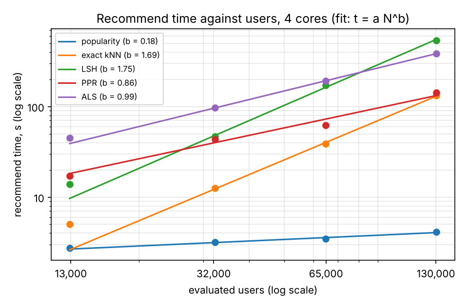

# Scalable Top-10 Movie Recommendation on MovieLens 20M: Exact Methods against MinHash-LSH and Monte Carlo PageRank on Spark

ENSF 612 L01, Engineering Large-Scale Data Analytics Systems, Fall 2026 · Group 9
Department of Electrical and Software Engineering, Schulich School of Engineering, University of Calgary

| Member | UCID |
|---|---|
| Vineeth Donthamsetty | 30332178 |
| Godfred Nanoa | 30328912 |
| Iruobe Akpatason | 30336389 |
| Ravan Maharramli | 30326649 |

Source code and all result files: <https://github.com/ENSF612LargeScaleDataAnalyticsSystem/ENSF612_Group9>

## Abstract

We recommend ten unseen movies to every user of MovieLens 20M (20,000,263 ratings by 138,493 users on
26,744 rated movies) and ask what the course's approximation techniques buy at this scale. Five methods are
implemented on Apache Spark 4.0.1: a popularity baseline, exact user-kNN, MinHash-LSH user-kNN, Monte Carlo
personalized PageRank (PPR) on the user–movie like graph, and implicit-feedback ALS from Spark MLlib. All
methods share one pipeline: the same cleaning, two time-ordered splits (`user_time`, per-user hold-out;
`global_time`, one global cut-off), tuning on a 10% user sample, one test run per method and split,
Precision/Recall/NDCG@10 with 95% bootstrap intervals and paired bootstrap comparisons. ALS is the most
accurate method (test NDCG@10 0.1474 on `user_time`, against 0.1367 for exact kNN and 0.0806 for
popularity), and the ranking ALS > kNN ≈ LSH > PPR > popularity is the same on both splits. MinHash-LSH
recovers 0.9164 of the exact top-100 neighbours and ties exact kNN in accuracy, but with the banding that
tuning required it is slower at every data size (535.49 s against 132.33 s at 100% of the users) and its
fitted growth (users^1.75) gives no break-even size. Monte Carlo PPR, in contrast, overlaps exact PPR's
top 10 by 0.8732 at about 80 times less computation. Exact kNN grows close to the square of the users,
while ALS and PPR grow about linearly.

## 1. Introduction

**Application and motivation.** Recommendations shape much of what people watch: Netflix reports that its
recommender influences about 80% of the hours streamed and saves it more than $1B a year [1]. Simple methods
remain hard to beat: when recent neural recommenders were re-run carefully, most lost to well-tuned
nearest-neighbour or graph-based baselines [2]. The difficulty is scale. A user-based neighbourhood method
compares users with each other, up to 9.59 billion pairs on MovieLens 20M, and a random-walk method needs one
personalized PageRank vector per user, 138,493 of them here. Both costs grow faster than the data. The course
offers two remedies for exactly these problems, MinHash with locality-sensitive hashing for similarity search
[5], [11], [12] and Monte Carlo estimation of PageRank [4], and this project measures what they cost and save
on a real data set, on Spark.

**Problem.** For every user, recommend the ten movies they have not rated that they are most likely to like
(rate 4.0 or more) in their next, held-out ratings.

**Research questions** (from our proposal):

- **RQ1 (quality).** Which of the five methods produces the best top-10 lists on a time-based hold-out, and
  does the ranking change on a split with one global cut-off date?
- **RQ2 (approximation).** How much neighbour recall and NDCG@10 do MinHash-LSH and Monte Carlo PPR lose
  against exact computation, for different signature lengths, bandings (b, r) and numbers of walks, and how
  much wall-clock time and shuffle volume do they actually save?
- **RQ3 (scalability).** How do run time, memory and shuffle volume grow from 10% to 100% of the users and
  from 1 to 4 cores, and at what size does each approximation become cheaper than its exact counterpart?

**Expected outcome.** The proposal expected the learned and neighbourhood methods to beat popularity, the
approximations to lose little accuracy, and the approximations to become cheaper than exact computation as
the data grows.

**Contributions.**

1. A reproducible Spark pipeline for MovieLens 20M: data checks and cleaning, two leakage-aware time splits,
   nested user samples, and one evaluation shared by all methods, whose results do not depend on the number
   of cores.
2. Implementations of exact user-kNN, MinHash-LSH user-kNN and Monte Carlo PPR on Spark, plus ALS from MLlib
   with our own exact top-k scoring, each tuned on validation data and tested once.
3. A measurement of both approximations against their exact counterparts: neighbour recall and paired NDCG
   for LSH, overlap with exact PPR (computed exactly by power iteration) for Monte Carlo PPR.
4. A scalability study on one machine: time against data size and cores, fitted growth exponents and
   break-even sizes, shuffle volume and memory.

Section 2 reviews related work, Section 3 the data, Section 4 the methods, Section 5 the implementation,
Section 6 the experimental design, Section 7 the results, Section 8 discusses them, Section 9 concludes and
Section 10 lists each member's contribution. Tuning tables and further details are in the appendices.

## 2. Related Work

**Neighbourhood methods and strong baselines.** User-based collaborative filtering scores an item by the
votes of similar users. Ferrari Dacrema et al. [2] showed that such simple, well-tuned neighbourhood and
graph methods often beat recent neural recommenders, which is why we compare classic methods rather than
deep models, and why we keep a popularity baseline that every method must beat.

**Similarity search at scale.** MinHash estimates the Jaccard similarity of two sets from short signatures
[11], and banding the signatures (locality-sensitive hashing) turns all-pairs comparison into bucket
lookups whose candidate probability is an S-curve in the similarity [12], [5]. Google News used MinHash
clustering on MapReduce to personalise news for millions of users without comparing every pair [3]. Our LSH
method follows this design: map tasks compute signatures and band keys, Spark groups users by bucket, and
only candidates are scored exactly.

**Random walks for recommendation.** PageRank [13] ranks graph nodes by the stationary distribution of a
random walk; personalising the restart turns it into a recommender, as in ItemRank [14]. RP3beta [18] showed
that dividing walk-based scores by item popularity raises both accuracy and diversity; our PPR uses the same
penalty. Computing one exact PPR vector per user is expensive, and Bahmani et al. [4] estimated many PPR
vectors on MapReduce by Monte Carlo walks. We use the same estimator and, unlike most applications,
measure it against exact PPR computed by power iteration.

**Matrix factorisation.** Hu, Koren and Volinsky [15] adapted matrix factorisation to implicit feedback with
confidence weights and alternating least squares. Spark MLlib provides a distributed implementation [16]; we
use it as the learned reference that the neighbourhood and graph methods are compared with.

**Evaluation methodology.** Random or per-user splits can leak future information into training [8], and
the choice of split changes the ranking of methods [9]. We therefore report a per-user time split and a split
with one global cut-off date, and check whether the ranking changes. NDCG [17] is the main metric.

**How this project differs.** Earlier work typically studies one of these techniques at a time, on a cluster.
We compare exact and approximate versions of two families side by side, on the same data and evaluation, and
measure accuracy, neighbour recall, time, shuffle and memory together, on Spark in local mode, to find where
each approximation starts to pay off.

## 3. Dataset and Data Preparation

### 3.1 Source and format

MovieLens 20M is the stable benchmark release of GroupLens [6], [7]. It comes as six UTF-8 CSV files; we
use `ratings.csv` (userId, movieId, rating from 0.5 to 5.0 in half-star steps, Unix timestamp) and
`movies.csv` (movieId, title with year, pipe-separated genres). Users were selected at random among those
with at least 20 ratings, and no demographic data is included [7]. The data is used under the GroupLens
README; every member downloads it directly and it is never committed.

### 3.2 Size and profile

`src/ingest.py` profiles the data and writes `reports/data_profile.md`:

| Statistic | Value |
|---|---|
| Ratings | 20,000,263 |
| Users | 138,493 |
| Movies with at least one rating (in `movies.csv`) | 26,744 (27,278) |
| Density of the user–movie matrix | 0.54% |
| Likes (rating ≥ 4.0) | 9,995,410 (49.98%) |
| Period | 1995-01-09 to 2015-03-31 |
| Ratings per user: min / median / mean / p99 / max | 20 / 68 / 144.41 / 1114 / 9254 |
| Ratings per movie: min / median / mean / p99 / max | 1 / 18 / 747.84 / 14396 / 67310 |
| Share of ratings on the top 1% of movies | 33.48% |
| Ratings that share a timestamp with another rating of the same user | 30.9% |

The data is very sparse and skewed: a third of all ratings go to the top 1% of movies while the median movie
has 18 ratings. A dense user–movie matrix would hold 3.8 billion cells, so every structure in the pipeline
is sparse.

### 3.3 Data quality and cleaning

`src/ingest.py` applies five rules and counts each one in `reports/data_quality.json`, even when the count
is zero: missing or unparseable fields, ratings outside 0.5–5.0 or off the half-star grid, timestamps
outside the collection period, `movieId` missing from `movies.csv`, and duplicate user–movie pairs (latest
kept). On MovieLens 20M every rule removed 0 rows (20,000,263 raw and clean); the rules stay in the
pipeline so the data is checked, not assumed clean. 534 movies in `movies.csv` have no rating and get no
dense id; 23 titles have no year and 246 movies have no genres, which does not matter because no method
uses titles or genres. Users and movies are never removed for being unusual.

**Transformation.** User and movie ids are mapped to dense integers from 0, timestamps are kept as Unix
seconds, and every table is written as Parquet with the columns `user, item, rating, ts, like`. A rating of
4.0 or more is a **like**: likes are the positive signal of every method and of the evaluation. 206 users
have no like at all; they still receive recommendations (popular movies) and are evaluated like everyone
else.

**Limitations and biases.** MovieLens users are volunteers who choose what to rate, so popular films are
over-represented and missing ratings are not random. Timestamps record when a rating was entered, not when
the film was watched, and 30.9% of ratings share a timestamp with another rating of the same user (bulk
rating sessions), so any time split only approximates a live service.

### 3.4 Splits

**`user_time`.** Each user's ratings are sorted by (timestamp, movie id); the last ceil(20%) are test and the
ceil(10%) before them validation. The movie id makes ties deterministic. Every user keeps at least 13
training ratings.

**`global_time`.** Two cut-offs shared by all users: the latest 20% of all ratings are test (from
2009-10-20) and the 10% before them validation (from 2007-12-08). This is the strict, realistic setting, but
it can evaluate only returning users on movies seen in training: at the test stage 5,542 users are
evaluable, 26,027 users in the test period have no training history, and 300,783 of the 1,998,613 test
likes are on movies absent from training, which caps recall.

**Samples.** `user_time_10pct` and `global_time_10pct` keep 10% of the users. Users are chosen by a hash of
their id, not by a random draw, so the 10%, 25% and 50% samples are nested and identical on every machine.
All tuning used the validation stage of `user_time_10pct`.

| Split | Train ratings | Evaluable users (val / test) |
|---|---|---|
| user_time | 13,883,097 | 130,411 / 135,599 |
| user_time_10pct | 1,382,688 | 12,905 / 13,385 |
| global_time | 14,000,184 | 4,538 / 5,542 |

Full per-part statistics are in Appendix B.

## 4. Methodology

### 4.1 Common structure

Every method is a function `recommend(spark, train, k=10, **params)` that receives the training ratings
only and returns, for every user, ten distinct movies the user has not rated in training. All methods except
popularity use the same three sparse indexes built from the training likes (user → rated movies, user →
liked movies, movie → users who liked it), score users in fixed batches of 256, and fill a list shorter than
ten with the most popular unseen movies. Table 1 summarises the methods and their costs.

*Table 1. Methods and their main cost (N users, L likes, d = likes of a movie, W walkers, S steps, r rank).*

| Method | Signal | Main cost | Chosen parameters |
|---|---|---|---|
| Popularity | most-liked unseen movies | O(L) | none |
| Exact user-kNN | cosine on liked sets, 100 neighbours | Σ over movies of d² | 100 neighbours, cosine |
| MinHash-LSH user-kNN | as kNN, neighbours from LSH candidates | N · n hashes + candidates | 256 hashes, 128 bands, cosine, 100 neighbours |
| Monte Carlo PPR | visit counts of random walks | N · W · S | alpha 0.3, 2,500 walkers, 20 steps, beta 0.3, min_visits 10 |
| ALS (MLlib) | implicit matrix factorisation | iterations · (L r² + (N + M) r³) | rank 128, alpha 1.0, reg 0.1 |

### 4.2 Popularity

Movies are ranked by their number of likes in training (ties by number of ratings, then id); each user gets
the ten best they have not rated. Every other method must beat it.

### 4.3 Exact user-kNN

For a user u with liked set A_u, the method walks the movie → likers index for every movie in A_u and counts
how often each other user appears, which gives |A_u ∩ A_v| for all v at once. The similarity is cosine on the
liked sets, |A_u ∩ A_v| / sqrt(|A_u| · |A_v|), and the 100 most similar users are kept (ties to the lower id).
A movie's score is the sum of the similarities of the neighbours who liked it. The cost per user is the total
number of likes of the movies the user liked, so summed over users it is the sum over movies of (likes)²:
popular movies dominate, and the cost grows close to the square of the number of users.

### 4.4 MinHash-LSH user-kNN

LSH replaces only the neighbour search; scoring is the same code as exact kNN, so any accuracy difference
comes from the neighbours alone.

1. **Signatures.** Each liked set gets n values h_j = min over x in A_u of (a_j x + b_j) mod (2^31 − 1), with
   a_j, b_j drawn from seed 612. Two users agree on one value with probability equal to their Jaccard
   similarity [11].
2. **Banding.** The signature is cut into b bands of r = n / b values; users who share a bucket in at least
   one band become candidates. A pair with Jaccard similarity s is found with probability
   1 − (1 − s^r)^b [5], [12].
3. **Bucket cap.** Buckets with more than 2,000 users are skipped; they come from very popular movies and
   would bring back the quadratic cost.
4. **Verification.** The exact similarity of every candidate is computed and the 100 best are kept.

The proposal's bandings (4 values per band, threshold about 0.42) found too few candidates, because true
neighbours in this data have low Jaccard similarity (Appendix A.2): tuning moved to 2 values per band, 256
hashes in 128 bands.

### 4.5 Monte Carlo personalized PageRank

Users and movies are the nodes of a bipartite graph with an edge for every training like. For a user u,
W walkers start at u; at each of S = 20 steps a walker moves to a random movie its current user liked (the
visit is counted), then to a random user who liked that movie, and with probability alpha = 0.3 jumps back to
u. Visit counts estimate u's PPR scores [4], [13]. Two rules from tuning make the scores useful: movies with
fewer than min_visits = 10 visits are dropped as noise, and counts are divided by (likes of the movie)^beta
with beta = 0.3, the popularity penalty of RP3beta [18].

**Exact reference.** For RQ2 the expected visit counts of this same walk are computed exactly. With P_UM and
P_MU the user → movie and movie → user transition matrices, x_0 = e_u and
x_(t+1) = alpha · e_u + (1 − alpha) · x_t P_UM P_MU, the expected visits are W · Σ_t x_t P_UM over the 20
steps (`tools/ppr_exact.py`). This is exact PPR for the walk the method simulates, so the overlap of the two
top-10 lists measures the Monte Carlo error alone.

### 4.6 ALS

ALS factorises the user–movie preference matrix into user and movie factors of rank r. We use the
implicit-feedback model [15] from Spark MLlib [16] on the training likes: alpha sets the confidence of an
observed like and reg the L2 penalty. MLlib's own `recommendForAllUsers` cannot exclude seen movies, so the
factors are collected and every user's scores U·Vᵀ are computed in batches with our own top-k, which removes
all rated movies.

### 4.7 Parameter selection and design decisions

Each method was tuned on the validation stage of `user_time_10pct` (12,905 evaluated users) by NDCG@10, from
defaults by changing one or two parameters at a time; Appendix A lists every configuration tried. The chosen
values were fixed in `tools/chosen.json` before any test run. Design decisions that differ from the proposal,
and why:

| Proposal | What we did | Why |
|---|---|---|
| Jaccard, top-20 neighbours | Cosine, 100 neighbours for kNN and LSH | Best on validation (Appendix A.1) |
| Bandings from 32 × 4 to 85 × 3 | 256 hashes in 128 bands (2 values per band) | With 4 values per band the pilot found about 24 candidates per user and none for 4,027 users |
| PPR: restart 0.15, ranked by raw visit counts, walks as map-reduce rounds | Restart 0.3, 2,500 walkers, beta 0.3, min_visits 10; walks of each 256-user batch simulated with numpy inside one Spark task | Raw counts were far below the chosen rules on the pilot (Appendix A.3); batches avoid a shuffle per step and keep results independent of the core count |
| Random 10/25/50% samples | Samples by a hash of the user id | Nested and identical on every machine |

## 5. Implementation

**Languages and libraries.** Python 3.11, PySpark 4.0.1 (Spark SQL, MLlib ALS) in local mode, NumPy, SciPy
(sparse matrices for exact PPR), matplotlib for figures and pytest for tests. Apart from Spark, MLlib's ALS
training and these numerical libraries, the algorithmic code (cleaning, splits, evaluation, bootstrap,
kNN, MinHash and banding, random walks, exact PPR, ALS scoring and top-k) was written by the group.

**Software architecture.** The pipeline is three scripts and one module per method:

```
ml-20m CSV  -> src/ingest.py   -> Parquet with dense ids, data profile
            -> src/split.py    -> user_time, global_time, 10% pilots
            -> src/run.py      -> src/methods/<name>.recommend(train)
                               -> top-10 lists
            -> src/evaluate.py -> per-user metrics, bootstrap CIs
```

`src/common.py` holds every project rule (like threshold 4.0, test 20%, validation 10%, k = 10, seed 612,
paths, the shared Spark configuration and the user sampler), so a rule changes in one place for all methods.
Tools in `tools/` handle the group workflow (identity checks before test runs, single test runs), paired
comparisons, scalability runs, growth fits, exact PPR, shuffle and memory measurements and the figures.

**Data structures.** `src/methods/_shared.py` collects the training ratings once and builds three
compressed-sparse-row arrays with NumPy (user → rated movies, user → liked movies, movie → users who liked
it). They are broadcast to every Spark worker. Users are sorted by id and cut into fixed batches of 256 that
are scored in parallel with `mapPartitions`. This trades shuffle for memory: kNN, PPR and ALS scoring move
almost no data between tasks, but each worker holds a copy of the index (Section 7.5).

**Determinism.** Batches depend only on user ids; every top-n selection breaks ties by the lower id; LSH
hash functions, PPR walks (one generator per batch, seeded with (612, first user of the batch)) and ALS
(fixed seed and block counts) are seeded. The bootstrap sorts users before resampling. As a result every
method produces identical lists on 1, 2 and 4 cores (Section 7.4).

**Computational environment.** Tuning and the popularity and kNN test runs: Windows, 4 CPUs, 8 GB driver
memory. LSH, PPR and ALS test runs and all scalability, shuffle and memory runs: macOS 27.0.1 on Apple
Silicon, 10 CPUs, 24 GB RAM, 14 GB driver memory (8 GB ran out of memory for LSH).

**Testing and reproducibility.** 17 unit tests check the metrics by hand, the rejection of malformed lists,
the splits and cut-offs, the top-k and tie rules, the method contract, and kNN, LSH and PPR on small
hand-checked cases. Before any test run, `tools/member.py check` confirms that the machine's
data profile and split statistics equal the group's, and `tools/member.py pilot` must reproduce the group's
pilot metrics (within 0.002). The repository README gives the commands to reproduce every experiment
(summarised in Appendix E).

## 6. Experimental Design

**Stages.** On each split, the *validation stage* trains on train and scores on validation; all tuning used
it. The *test stage* trains on train + validation and scores on test, once per method and split, with the
parameters from `tools/chosen.json`; the tool refuses to run a test split twice.

**Who is evaluated.** A user with at least one liked target movie and at least one training rating. A user
for whom a method returns no list still counts with 0, so no method can gain by skipping hard users.

**Metrics.** With k = 10 and binary relevance (a hit is a movie the user liked in the target part):
Precision@10 = hits / 10, Recall@10 = hits / R (R liked target movies) and NDCG@10 = DCG / IDCG with
DCG = Σ over hits of 1 / log2(rank + 1) [17], averaged over evaluated users; coverage is the share of the
training catalogue recommended to anyone.

**Uncertainty and comparisons.** Each metric has a 95% percentile bootstrap interval over users (1,000
resamples, seed 612). Two methods are compared with a *paired* bootstrap on the same users and resamples,
reporting the mean difference, its interval and the share of resamples where A is not better than B.

**Baselines.** Popularity for every method; exact kNN for LSH; exact PPR for Monte Carlo PPR.

**Leakage safeguards.** Methods receive only the training DataFrame and never read validation or test;
splits are time-ordered (strictly across users only in `global_time`, which is why it is included [8]);
rated movies are never recommended; parameters were fixed before any test run.

**Approximation experiments (RQ2).** LSH: `tools/lsh_recall.py` compares the LSH and exact top-100 neighbours
of 1,993 sampled users on the full `user_time` validation training data. PPR: `tools/ppr_exact.py` compares
Monte Carlo and exact top-10 lists for 2,000 sampled users of the same data, for W = 100, 250, 1,000 and
2,500 walkers, in the same process on one core.

**Scalability experiments (RQ3).** On one machine, every method with its chosen parameters on the
`user_time` validation stage: 10%, 25%, 50% and 100% of the users on 4 cores, and 1 and 2 cores on the 25%
sample (30 runs). The measured time is the wall-clock time of `recommend` (index, training, scoring,
writing). `tools/growth.py` fits t = a · N^b to the 25–100% runs. `tools/sysmetrics.py` repeats the size runs
and reads shuffle and spill from Spark's monitoring REST API and the peak JVM heap and resident memory.

## 7. Results

### 7.1 Accuracy (RQ1)

*Table 2. Test results, one run per method and split (95% bootstrap intervals).*

| Split | Method | P@10 | R@10 | NDCG@10 | Coverage |
|---|---|---|---|---|---|
| user_time (135,599 users) | ALS | 0.1120 [0.1113, 0.1128] | 0.1216 [0.1206, 0.1226] | 0.1474 [0.1464, 0.1484] | 0.0854 |
| | exact kNN | 0.1034 [0.1027, 0.1041] | 0.1140 [0.1131, 0.1151] | 0.1367 [0.1357, 0.1377] | 0.0875 |
| | MinHash-LSH | 0.1033 [0.1025, 0.1040] | 0.1138 [0.1128, 0.1148] | 0.1366 [0.1355, 0.1376] | 0.0879 |
| | PPR | 0.0749 [0.0743, 0.0755] | 0.0821 [0.0812, 0.0829] | 0.0985 [0.0976, 0.0993] | 0.0602 |
| | popularity | 0.0619 [0.0613, 0.0624] | 0.0619 [0.0612, 0.0626] | 0.0806 [0.0798, 0.0814] | 0.0129 |
| global_time (5,542 users) | ALS | 0.1994 [0.1929, 0.2054] | 0.0519 [0.0497, 0.0546] | 0.2221 [0.2150, 0.2288] | 0.1613 |
| | exact kNN | 0.1898 [0.1835, 0.1959] | 0.0503 [0.0481, 0.0528] | 0.2130 [0.2061, 0.2196] | 0.1390 |
| | MinHash-LSH | 0.1901 [0.1835, 0.1961] | 0.0506 [0.0483, 0.0532] | 0.2125 [0.2054, 0.2190] | 0.1413 |
| | PPR | 0.1415 [0.1359, 0.1468] | 0.0370 [0.0349, 0.0395] | 0.1589 [0.1531, 0.1645] | 0.0606 |
| | popularity | 0.1262 [0.1212, 0.1313] | 0.0337 [0.0318, 0.0362] | 0.1438 [0.1383, 0.1494] | 0.0267 |

*Table 3. Paired bootstrap of NDCG@10 differences (A − B), 1,000 resamples of the same users.*

| A − B | user_time | P(A ≤ B) | global_time | P(A ≤ B) |
|---|---|---|---|---|
| ALS − kNN | +0.0107 [+0.0100, +0.0114] | 0.000 | +0.0091 [+0.0055, +0.0128] | 0.000 |
| LSH − kNN | −0.0001 [−0.0003, +0.0001] | 0.918 | −0.0005 [−0.0014, +0.0004] | 0.854 |
| PPR − kNN | −0.0382 [−0.0390, −0.0375] | 1.000 | −0.0540 [−0.0578, −0.0504] | 1.000 |
| ALS − PPR | +0.0489 [+0.0480, +0.0498] | 0.000 | +0.0632 [+0.0582, +0.0681] | 0.000 |
| ALS − popularity | +0.0668 [+0.0658, +0.0678] | 0.000 | +0.0783 [+0.0729, +0.0836] | 0.000 |

Every method beats popularity on every metric on both splits, with all paired intervals above zero
(Appendix C). The ranking by NDCG@10 is ALS > exact kNN ≈ LSH > PPR > popularity on both splits.

### 7.2 MinHash-LSH against exact kNN (RQ2)

| Data | Users compared | Neighbour recall@100 | Similarity ratio | Candidates per user |
|---|---|---|---|---|
| 10% pilot | | 0.8247 | 0.9464 | 1,885.7 |
| Full `user_time` | 1,993 | 0.9164 | 0.9898 | 11,665.3 (median 11,371) |

On the full data LSH finds 0.9164 of the exact top-100 neighbours, and the neighbours it keeps carry 0.9898
of the exact similarity mass. The resulting recommendations are statistically indistinguishable from exact
kNN (Table 3, LSH − kNN). Time and shuffle are in Sections 7.4 and 7.5.

### 7.3 Monte Carlo PPR against exact PPR (RQ2)

*Table 4. 2,000 sampled users, `user_time` validation stage. "Raw": no penalty, no visit filter, which
measures the approximation itself; "chosen rules": beta 0.3 on both sides, min_visits 10 on the Monte Carlo
side.*

| Walkers W | Overlap@10, raw | NDCG@10, raw | Overlap@10, chosen rules | NDCG@10, chosen rules | Monte Carlo s per 1,000 users |
|---|---|---|---|---|---|
| 100 | 0.5089 | 0.0644 | 0.7568 | 0.0681 | 0.48 |
| 250 | 0.6509 | 0.0721 | 0.5335 | 0.0705 | 0.55 |
| 1,000 | 0.8062 | 0.0790 | 0.7294 | 0.0822 | 1.0 |
| 2,500 (chosen) | 0.8732 | 0.0797 | 0.8238 | 0.0842 | 1.86 |

Exact PPR reaches NDCG@10 0.0802 raw and 0.0867 with the penalty, at 152.68 s per 1,000 users on the same
core. Raw overlap rises from 0.5089 to 0.8732 with W, and every W is far cheaper than the exact computation.

### 7.4 Time against data size and cores (RQ3)



*Table 5. Recommend time on 4 cores (evaluated users 12,905 / 32,278 / 64,883 / 130,411) and fitted growth
t = a · N^b on the 25–100% runs.*

| Method | 10% | 25% | 50% | 100% | Exponent b | Predicted at 10× users |
|---|---|---|---|---|---|---|
| popularity | 2.73 s | 3.19 s | 3.49 s | 4.11 s | 0.18 | 6 s |
| exact kNN | 5.06 s | 12.52 s | 38.91 s | 132.33 s | 1.69 | 6,366 s |
| LSH | 13.92 s | 46.65 s | 172.75 s | 535.49 s | 1.75 | 30,864 s |
| PPR | 17.13 s | 43.18 s | 62.36 s | 142.84 s | 0.86 | 951 s |
| ALS | 44.97 s | 97.01 s | 190.82 s | 385.66 s | 0.99 | 3,738 s |

*Table 6. Recommend time on the 25% sample against cores.*

| Method | 1 core | 2 cores | 4 cores | Speed-up 1→4 |
|---|---|---|---|---|
| popularity | 3.36 s | 3.03 s | 3.19 s | 1.05× |
| exact kNN | 29.85 s | 18.26 s | 12.52 s | 2.38× |
| LSH | 117.43 s | 78.18 s | 46.65 s | 2.52× |
| PPR | 63.78 s | 56.69 s | 43.18 s | 1.48× |
| ALS | 182.61 s | 140.55 s | 97.01 s | 1.88× |

For every method NDCG@10 on the 25% sample is identical on 1, 2 and 4 cores (for example kNN 0.109253 and ALS
0.118417), so parallelism changes only the time. Figures with linear axes are in `report/figures/`.

### 7.5 Shuffle volume and memory (RQ2, RQ3)

*Table 7. Recommend phase, 4 cores, 14 GB driver memory.*

| Method | Shuffle write, 10% (MB) | Shuffle write, 100% (MB) | Peak JVM heap, 100% (GB) |
|---|---|---|---|
| popularity | 4.8 | 41.9 | 2.65 |
| exact kNN | 3.8 | 0.0 | 2.57 |
| LSH | 164.5 | 10,848.6 | 13.57 |
| PPR | 0.0 | 0.0 | 2.40 |
| ALS | 855.9 | 6,336.0 | 2.79 |

No run spilled to disk. Values below about 20 MB for popularity, kNN and PPR are measurement noise from
separating the recommend and evaluation phases by time; resident-memory figures are in Appendix D.

## 8. Analysis and Discussion

**Why ALS is the most accurate.** A likely reason is that ALS learns a dense taste vector for every user from
all of their likes at once, so two users who share no movie can still be close through movies that others
connect. Neighbourhood
scoring uses only users who share liked movies with the target user, and only the 100 nearest. The gain is
modest but certain: +0.0107 NDCG@10 over exact kNN with a paired interval of [+0.0100, +0.0114] on
`user_time`, and the same sign on `global_time`. Tuning showed that ALS depends mostly on the confidence
weight: alpha 1 was far better than the default 10, and using raw ratings as confidence was much worse
(Appendix A.4).

**Why LSH matches exact kNN.** Missing 8% of the top-100 neighbours costs almost nothing because the users
LSH keeps instead are almost as similar: its neighbours carry 0.9898 of the exact similarity mass. Movie
scores are sums over 100 neighbours, so the top 10 barely change (NDCG difference −0.0001, interval
containing zero).

**Why LSH saves no time (unexpected result).** The neighbours that matter have low Jaccard similarity in this
data, so only loose banding (2 values per band, threshold well below the proposal's 0.42) keeps them; the
proposal's 4-value bands left 4,027 pilot users with no candidates. Loose banding produces about 11,700
candidates per user, every one of which is verified exactly, and the bucket grouping adds about 10.6 GB of shuffle (10,848.6 MB)
and a 13.6 GB heap at 100% of the users. Exact kNN, by contrast, gets all overlaps of a user in one pass over
the movie → likers index, a cache-friendly operation on a broadcast array. The fitted exponents (1.75 for LSH,
1.69 for exact kNN) mean the curves do not cross: with this banding there is no break-even size, and at ten
times the users LSH is predicted to need about 30,900 s against 6,400 s. LSH would pay off only with
stricter banding, which in our data loses neighbours, or where the exact index no longer fits in memory.

**Why Monte Carlo PPR pays off.** Each walk step is a constant-time array lookup, so the cost is linear in
users × walkers × steps, while exact PPR needs repeated sparse matrix products over the whole graph for
every user. At the chosen 2,500 walkers the walks are about 80 times faster (1.86 against 152.68 s per
1,000 users); for all 130,411 users that is roughly 4 minutes against 5.5 hours on one core, for an overlap of
0.8732 with the exact top 10 and almost the same NDCG (0.0797 against 0.0802, raw). The overlap under the
chosen rules is not monotone in W (0.7568 at 100 walkers, 0.5335 at 250): with 100 walkers and min_visits 10
the median user keeps only 2 movies, 80.4% of the top-10 slots are filled with popular movies, and the exact
top 10 with the penalty consists of very popular movies too (`reports/ppr_fill_check.md`). The overlap at
W = 100 is therefore agreement through the popularity fill, not better estimates.

**Why PPR is the weakest personalised method.** Even exact PPR scores only 0.0802 NDCG@10 on the sample, so
the gap to kNN is a property of the walk, not of the sampling. Walks drift towards popular movies; the
penalty corrects this, but only together with the visit filter: without it, beta 0.3 dropped pilot NDCG@10 to
0.0226, because rarely visited movies with tiny like counts received the largest boost (Appendix A.3).

**The two splits.** `global_time` gives higher precision and NDCG but lower recall for every method. It
evaluates only 5,542 returning users whose test periods often hold many likes, so ten slots give high
precision but low recall, and it cannot count likes of movies that are new in the test period. Its intervals are about seven
times wider. Absolute numbers are therefore not comparable across splits, but the ranking of the methods is
identical, which is the question RQ1 asks.

**What drives scalability.** Popularity is dominated by fixed Spark overhead. ALS and PPR grow about linearly
with the users. Exact kNN and LSH grow almost quadratically because more users mean both more users to score
and more neighbours per user. With cores, kNN and LSH scale best (2.38× and 2.52× on 4 cores) because their
batches are independent; neither reaches 4× because the index is built and broadcast on the driver first.
ALS synchronises after every iteration over a fixed number of blocks (1.88×), and PPR gained least (1.48×).
The broadcast design keeps shuffle near zero for kNN and PPR, but every worker holds the whole index, so
memory, not the network, is the limit in local mode.

**Limitations.** All runs use Spark in local mode on single laptops; test-run times come from two kinds of
machine and are not compared (only the one-machine scalability runs are). Tuning used the `user_time` pilot
and was reused for `global_time`; the ALS and PPR grids changed one or two parameters at a time. PPR used one
seed. `global_time` cannot evaluate new users or new movies. The growth predictions extrapolate three sizes
with the catalogue fixed, and resident memory on macOS understates large heaps, so memory is compared by
JVM heap.

## 9. Conclusions and Future Work

**RQ1.** ALS gives the best top-10 lists (test NDCG@10 0.1474 on `user_time`, 0.2221 on `global_time`),
followed by exact kNN and LSH (tied), PPR and popularity. Every method beats popularity on both splits, and
the ranking does not change on the global split.

**RQ2.** MinHash-LSH loses almost nothing: 0.9164 neighbour recall@100 and −0.0001 NDCG@10 against exact
kNN. But with the banding needed to keep that recall it saves no time and moves far more data (10,848.6 MB
of shuffle, where exact kNN shuffles almost nothing). Monte Carlo PPR at 2,500 walkers overlaps exact PPR by
0.8732 at about 80 times less computation, so it is the approximation that pays off.

**RQ3.** Exact kNN grows as users^1.69 and LSH as users^1.75, so this LSH configuration has no break-even
size; ALS (0.99) and PPR (0.86) grow about linearly. Four cores speed up kNN and LSH about 2.4–2.5× and the
results are identical on any number of cores. Peak JVM heap at 100% of the users ranges from 2.40 GB (PPR)
to 13.57 GB (LSH).

**Overall.** For this data size on one machine, ALS is the best choice for accuracy at linear cost, exact kNN
is the fastest accurate method but grows fastest, and of the two approximations only Monte Carlo PPR saves
time.

**Future work.** (1) Tune LSH for time as well as accuracy, for example with multi-probe LSH or a bucket cap
tuned per band, and test on a larger catalogue where the exact index no longer fits in memory. (2) Run the
methods on a multi-node cluster, where the broadcast design and LSH's shuffle trade off differently. (3)
Evaluate cold start for new users and movies, which `global_time` currently excludes, for example with
genres or tag-genome features. (4) Measure the variance of PPR over several seeds and tune ALS with a full
grid.

## 10. Individual Contributions

| Member | Contribution |
|---|---|
| Vineeth Donthamsetty | ALS (tuning analysis, test runs, report section); evaluation-protocol section; integration of all branches, result verification and paired comparisons; the 30 scalability runs; growth and break-even analysis, exact-PPR comparison, shuffle and memory measurements; report assembly |
| Godfred Nanoa | Shared foundation: ingestion and cleaning, the two splits, evaluation, run harness, the five method implementations and their pilot tuning, group workflow tools; exact kNN test runs and report section |
| Iruobe Akpatason | Monte Carlo PPR test runs, analysis and report section; dataset section of the report |
| Ravan Maharramli | MinHash-LSH test runs, full-data neighbour-recall measurement and report section |

## References

[1] C. A. Gomez-Uribe and N. Hunt, “The Netflix recommender system: Algorithms, business value, and innovation,” ACM Trans. Manage. Inf. Syst., vol. 6, no. 4, Art. no. 13, 2015, doi: 10.1145/2843948.

[2] M. Ferrari Dacrema, P. Cremonesi, and D. Jannach, “Are we really making much progress? A worrying analysis of recent neural recommendation approaches,” in Proc. 13th ACM Conf. Recommender Systems (RecSys), 2019, doi: 10.1145/3298689.3347058.

[3] A. Das, M. Datar, A. Garg, and S. Rajaram, “Google news personalization: Scalable online collaborative filtering,” in Proc. 16th Int. Conf. World Wide Web (WWW), Banff, AB, Canada, 2007, pp. 271–280, doi: 10.1145/1242572.1242610.

[4] B. Bahmani, K. Chakrabarti, and D. Xin, “Fast personalized PageRank on MapReduce,” in Proc. ACM SIGMOD Int. Conf. Management of Data, 2011, doi: 10.1145/1989323.1989425.

[5] J. Leskovec, A. Rajaraman, and J. D. Ullman, Mining of Massive Datasets, 3rd ed. Cambridge, U.K.: Cambridge Univ. Press, 2020.

[6] F. M. Harper and J. A. Konstan, “The MovieLens datasets: History and context,” ACM Trans. Interact. Intell. Syst., vol. 5, no. 4, Art. no. 19, Dec. 2015.

[7] GroupLens Research, “MovieLens 20M dataset (ml-20m) README.” [Online]. Available: https://files.grouplens.org/datasets/movielens/ml-20m-README.html (accessed Oct. 19, 2026).

[8] Y. Ji, A. Sun, J. Zhang, and C. Li, “A critical study on data leakage in recommender system offline evaluation,” ACM Trans. Inf. Syst., vol. 41, no. 3, 2023, doi: 10.1145/3569930.

[9] Z. Meng, R. McCreadie, C. Macdonald, and I. Ounis, “Exploring data splitting strategies for the evaluation of recommendation models,” in Proc. 14th ACM Conf. Recommender Systems (RecSys), 2020, pp. 681–686, doi: 10.1145/3383313.3418479.

[10] M. Zaharia et al., “Apache Spark: A unified engine for big data processing,” Commun. ACM, vol. 59, no. 11, pp. 56–65, Nov. 2016.

[11] A. Z. Broder, “On the resemblance and containment of documents,” in Proc. Compression and Complexity of SEQUENCES 1997, 1997, pp. 21–29.

[12] P. Indyk and R. Motwani, “Approximate nearest neighbors: Towards removing the curse of dimensionality,” in Proc. 30th Annu. ACM Symp. Theory of Computing (STOC), 1998, pp. 604–613.

[13] L. Page, S. Brin, R. Motwani, and T. Winograd, “The PageRank citation ranking: Bringing order to the web,” Stanford InfoLab, Stanford, CA, USA, Tech. Rep., 1999.

[14] M. Gori and A. Pucci, “ItemRank: A random-walk based scoring algorithm for recommender engines,” in Proc. 20th Int. Joint Conf. Artificial Intelligence (IJCAI), 2007, pp. 2766–2771.

[15] Y. Hu, Y. Koren, and C. Volinsky, “Collaborative filtering for implicit feedback datasets,” in Proc. 8th IEEE Int. Conf. Data Mining (ICDM), 2008, doi: 10.1109/ICDM.2008.22.

[16] Apache Software Foundation, “Collaborative filtering,” Apache Spark 4.0.1 Documentation. [Online]. Available: https://spark.apache.org/docs/4.0.1/ml-collaborative-filtering.html (accessed Oct. 19, 2026).

[17] K. Järvelin and J. Kekäläinen, “Cumulated gain-based evaluation of IR techniques,” ACM Trans. Inf. Syst., vol. 20, no. 4, pp. 422–446, Oct. 2002.

[18] B. Paudel, F. Christoffel, C. Newell, and A. Bernstein, “Updatable, accurate, diverse, and scalable recommendations for interactive applications,” ACM Trans. Interact. Intell. Syst., vol. 7, no. 1, Art. no. 1, 2017, doi: 10.1145/2955101.

## Appendix A. Tuning on the validation stage of `user_time_10pct`

All runs on the validation stage of the 10% pilot (12,905 evaluated users); the test part was never read.
Recommend times come from the group's tuning machine. The chosen row is in bold.

### A.1 Exact user-kNN

| Configuration | P@10 | R@10 | NDCG@10 | Coverage | Recommend s |
|---|---|---|---|---|---|
| **100 neighbours, cosine (chosen)** | 0.0638 | 0.1310 | 0.1081 | 0.0533 | 74 |
| 100 neighbours, Jaccard | 0.0628 | 0.1290 | 0.1065 | 0.0558 | 54 |
| 50 neighbours, Jaccard (default) | 0.0624 | 0.1275 | 0.1057 | 0.0792 | 57 |
| 200 neighbours, Jaccard | 0.0618 | 0.1266 | 0.1050 | 0.0420 | 56 |
| 20 neighbours, Jaccard | 0.0605 | 0.1222 | 0.1021 | 0.1196 | 80 |

Accuracy changes little between 50 and 200 neighbours and is best at 100; cosine is slightly better than
Jaccard. Fewer neighbours give more varied lists (coverage 0.120 with 20 neighbours, 0.042 with 200).

### A.2 MinHash-LSH

Unlisted parameters keep their defaults: n_hashes 128, bands 32, n_neighbours 50, max_bucket 2,000, Jaccard.

| Tag | Parameters | P@10 | R@10 | NDCG@10 | Coverage | Recommend (s) |
|---|---|---|---|---|---|---|
| **chosen** | **n_hashes 256, bands 128, cosine, n_neighbours 100** | **0.0633** | **0.1295** | **0.1068** | **0.0773** | **152.6** |
| h64_b64 | n_hashes 64, bands 64 | 0.0624 | 0.1277 | 0.1058 | 0.0800 | 265.56 |
| h128_b128 | n_hashes 128, bands 128 | 0.0624 | 0.1276 | 0.1057 | 0.0800 | 309.1 |
| h256_b128 | n_hashes 256, bands 128 | 0.0623 | 0.1265 | 0.1049 | 0.0908 | 156.24 |
| h128_b64 | n_hashes 128, bands 64 | 0.0614 | 0.1236 | 0.1027 | 0.1028 | 128.35 |
| h128_b64_mb5000 | n_hashes 128, bands 64, max_bucket 5,000 | 0.0614 | 0.1236 | 0.1027 | 0.1028 | 116.91 |
| default | (defaults) | 0.0463 | 0.0994 | 0.0801 | 0.1537 | 112.49 |

On the pilot, the chosen configuration found 0.8247 of the exact top-100 neighbours with 1,885.7 candidates
per user. During the LSH test runs, each user had 12,493.0 candidates on average on `user_time` (360 users without candidates; 206 buckets with more than 2,000 users skipped) and 13,221.8 on `global_time` (142 users without candidates; 165 buckets skipped).

### A.3 Monte Carlo PPR

Unlisted parameters keep their defaults: alpha 0.3, n_walkers 100, n_steps 20, beta 0, min_visits 1.

| Tag | Parameters | P@10 | R@10 | NDCG@10 | Coverage | Recommend (s) |
|---|---|---|---|---|---|---|
| **a0.3_w2500_b0.3_mv10 (chosen)** | **alpha 0.3, 2500 walkers, beta 0.3, min_visits 10** | **0.0462** | **0.0963** | **0.0800** | **0.0462** | **120.08** |
| a0.5_w1000 | alpha 0.5, 1000 walkers | 0.0453 | 0.0929 | 0.0781 | 0.0214 | 91.58 |
| a0.3_w1000_b0.3_mv5 | alpha 0.3, 1000 walkers, beta 0.3, min_visits 5 | 0.0455 | 0.0933 | 0.0780 | 0.0607 | 137.98 |
| a0.3_w1000_b0.5_mv10 | alpha 0.3, 1000 walkers, beta 0.5, min_visits 10 | 0.0454 | 0.0959 | 0.0776 | 0.1427 | 153.91 |
| a0.3_w2500 | alpha 0.3, 2500 walkers | 0.0440 | 0.0896 | 0.0763 | 0.0142 | 158.4 |
| a0.3_w1000 | alpha 0.3, 1000 walkers | 0.0439 | 0.0882 | 0.0757 | 0.0163 | 98.21 |
| a0.3_w250 | alpha 0.3, 250 walkers | 0.0406 | 0.0826 | 0.0689 | 0.0291 | 69.24 |
| a0.3 | alpha 0.3 | 0.0356 | 0.0731 | 0.0608 | 0.0499 | 65.12 |
| default | (defaults) | 0.0356 | 0.0731 | 0.0608 | 0.0499 | 67.2 |
| a0.5 | alpha 0.5 | 0.0348 | 0.0739 | 0.0606 | 0.0689 | 65.4 |
| a0.1 | alpha 0.1 | 0.0340 | 0.0670 | 0.0581 | 0.0412 | 75.96 |
| a0.3_b0.3 | alpha 0.3, beta 0.3 | 0.0113 | 0.0309 | 0.0226 | 0.7236 | 76.45 |
| a0.5_b0.5 | alpha 0.5, beta 0.5 | 0.0002 | 0.0007 | 0.0004 | 0.5874 | 74.75 |
| a0.3_b0.5 | alpha 0.3, beta 0.5 | 0.0001 | 0.0004 | 0.0002 | 0.5507 | 66.09 |
| a0.3_b0.7 | alpha 0.3, beta 0.7 | 0.0001 | 0.0002 | 0.0002 | 0.4682 | 66.51 |

More walkers help with diminishing returns (alpha 0.3, no penalty: 0.0608 with 100 walkers, 0.0757 with
1,000, 0.0763 with 2,500). The penalty beta works only together with min_visits; without the visit filter it
collapses NDCG@10. The restart probability mattered little at 100 walkers.

### A.4 ALS

Unlisted parameters keep their defaults: rank 64, alpha 10, reg 0.05, 10 iterations, likes as the signal.

| Tag | Parameters | P@10 | R@10 | NDCG@10 | Coverage | Recommend (s) |
|---|---|---|---|---|---|---|
| **r128_a1_reg0.1 (chosen)** | **rank 128, alpha 1, reg 0.1** | **0.0688** | **0.1412** | **0.1170** | **0.1095** | **383.89** |
| r64_a0.3 | rank 64, alpha 0.3 | 0.0668 | 0.1346 | 0.1128 | 0.0720 | 109.03 |
| r64_a1 | rank 64, alpha 1 | 0.0667 | 0.1355 | 0.1127 | 0.0783 | 123.38 |
| r64_a3 | rank 64, alpha 3 | 0.0657 | 0.1356 | 0.1107 | 0.0936 | 131.68 |
| r128_a1 | rank 128, alpha 1 | 0.0643 | 0.1306 | 0.1095 | 0.0997 | 279.28 |
| r128_a1_it15 | rank 128, alpha 1, 15 iterations | 0.0639 | 0.1293 | 0.1091 | 0.1005 | 393.65 |
| r128 | rank 128 | 0.0604 | 0.1281 | 0.1030 | 0.1361 | 282.36 |
| r64_reg0.1 | rank 64, reg 0.1 | 0.0618 | 0.1283 | 0.1025 | 0.1236 | 124.65 |
| default | (defaults) | 0.0610 | 0.1275 | 0.1019 | 0.1186 | 115.95 |
| r64 | rank 64 | 0.0610 | 0.1275 | 0.1019 | 0.1186 | 116.22 |
| r64_reg0.01 | rank 64, reg 0.01 | 0.0609 | 0.1267 | 0.1015 | 0.1144 | 122.41 |
| r32 | rank 32 | 0.0614 | 0.1240 | 0.1008 | 0.0994 | 78.68 |
| r64_a40 | rank 64, alpha 40 | 0.0521 | 0.1129 | 0.0870 | 0.1543 | 122.21 |
| r64_rating | rank 64, ratings as confidence | 0.0399 | 0.0902 | 0.0659 | 0.2062 | 137.75 |

The confidence weight alpha mattered most. Rank and reg helped only slightly, and without a rank-64,
alpha-1, reg-0.1 run the effect of rank cannot be separated from that of reg; 15 iterations did not help.

## Appendix B. Split statistics

| Split | Part | Ratings | Share | Users | Movies | Likes |
|---|---|---|---|---|---|---|
| user_time | train | 13,883,097 | 69.41% | 138,493 | 20,656 | 7,087,069 |
| | val | 2,062,715 | 10.31% | 138,493 | 18,513 | 983,364 |
| | test | 4,054,451 | 20.27% | 138,493 | 25,139 | 1,924,977 |
| user_time_10pct | train | 1,382,688 | 69.42% | 13,671 | 13,616 | 705,219 |
| | val | 205,444 | 10.31% | 13,671 | 10,924 | 97,529 |
| | test | 403,760 | 20.27% | 13,671 | 14,654 | 190,945 |
| global_time | train | 14,000,184 | 70.0% | 100,793 | 9,696 | 7,047,751 |
| | val | 2,000,026 | 10.0% | 16,322 | 12,126 | 949,046 |
| | test | 4,000,053 | 20.0% | 31,670 | 26,349 | 1,998,613 |
| global_time_10pct | train | 1,400,308 | 70.3% | 9,936 | 9,127 | 704,545 |
| | val | 193,560 | 9.72% | 1,605 | 8,229 | 93,261 |
| | test | 398,024 | 19.98% | 3,168 | 14,557 | 195,887 |

| Split | Stage | Evaluable users | Target users without history | Target likes on movies unseen in training |
|---|---|---|---|---|
| user_time | val | 130,411 | 0 | 453 of 983,364 |
| user_time | test | 135,599 | 0 | 1,782 of 1,924,977 |
| user_time_10pct | val | 12,905 | 0 | 284 of 97,529 |
| user_time_10pct | test | 13,385 | 0 | 985 of 190,945 |
| global_time | val | 4,538 | 11,673 | 93,714 of 949,046 |
| global_time | test | 5,542 | 26,027 | 300,783 of 1,998,613 |
| global_time_10pct | val | 447 | 1,146 | 9,525 of 93,261 |
| global_time_10pct | test | 568 | 2,589 | 31,287 of 195,887 |

## Appendix C. Paired comparisons

Each method against popularity (paired bootstrap, 1,000 resamples of the same users; Δ = method − popularity):

**Exact kNN**

| Split | Metric | Difference | 95% interval |
|---|---|---|---|
| user_time | Precision@10 | +0.0415 | [+0.0409, +0.0421] |
| user_time | Recall@10 | +0.0521 | [+0.0511, +0.0530] |
| user_time | NDCG@10 | +0.0561 | [+0.0552, +0.0570] |
| global_time | Precision@10 | +0.0636 | [+0.0599, +0.0672] |
| global_time | Recall@10 | +0.0166 | [+0.0146, +0.0187] |
| global_time | NDCG@10 | +0.0692 | [+0.0648, +0.0733] |

**MinHash-LSH**

| Split | Users | ΔP@10 [95% CI] | ΔR@10 [95% CI] | ΔNDCG@10 [95% CI] |
|---|---|---|---|---|
| user_time | 135,599 | +0.0414 [+0.0408, +0.0421] | +0.0519 [+0.0509, +0.0527] | +0.0560 [+0.0551, +0.0568] |
| global_time | 5,542 | +0.0639 [+0.0603, +0.0675] | +0.0168 [+0.0147, +0.0190] | +0.0687 [+0.0643, +0.0728] |

**Monte Carlo PPR**

| Split | Users | ΔP@10 [95% CI] | ΔR@10 [95% CI] | ΔNDCG@10 [95% CI] |
|---|---|---|---|---|
| user_time | 135,599 | +0.0130 [+0.0127, +0.0133] | +0.0201 [+0.0196, +0.0207] | +0.0179 [+0.0174, +0.0183] |
| global_time | 5,542 | +0.0153 [+0.0135, +0.0170] | +0.0033 [+0.0021, +0.0044] | +0.0151 [+0.0131, +0.0170] |

**ALS**

| Split | Users | ΔP@10 [95% CI] | ΔR@10 [95% CI] | ΔNDCG@10 [95% CI] |
|---|---|---|---|---|
| user_time | 135,599 | +0.0502 [+0.0495, +0.0509] | +0.0596 [+0.0586, +0.0607] | +0.0668 [+0.0658, +0.0678] |
| global_time | 5,542 | +0.0732 [+0.0684, +0.0780] | +0.0181 [+0.0155, +0.0209] | +0.0783 [+0.0729, +0.0836] |

Between methods on `user_time` (135,599 users):

| A − B | ΔP@10 [95% CI] | ΔR@10 [95% CI] | ΔNDCG@10 [95% CI] | P(A ≤ B), NDCG |
|---|---|---|---|---|
| LSH − kNN | −0.0001 [−0.0002, +0.0000] | −0.0002 [−0.0005, +0.0000] | −0.0001 [−0.0003, +0.0001] | 0.918 |
| ALS − kNN | +0.0086 [+0.0081, +0.0091] | +0.0076 [+0.0068, +0.0084] | +0.0107 [+0.0100, +0.0114] | 0.000 |
| PPR − kNN | −0.0285 [−0.0291, −0.0279] | −0.0319 [−0.0328, −0.0312] | −0.0382 [−0.0390, −0.0375] | 1.000 |
| ALS − LSH | +0.0088 [+0.0083, +0.0092] | +0.0078 [+0.0070, +0.0086] | +0.0108 [+0.0101, +0.0115] | 0.000 |
| ALS − PPR | +0.0371 [+0.0365, +0.0378] | +0.0395 [+0.0386, +0.0405] | +0.0489 [+0.0480, +0.0498] | 0.000 |
| ALS − popularity | +0.0502 [+0.0495, +0.0509] | +0.0596 [+0.0586, +0.0607] | +0.0668 [+0.0658, +0.0678] | 0.000 |

Between methods on `global_time` (5,542 users):

| A − B | ΔP@10 [95% CI] | ΔR@10 [95% CI] | ΔNDCG@10 [95% CI] | P(A ≤ B), NDCG |
|---|---|---|---|---|
| LSH − kNN | +0.0003 [−0.0007, +0.0012] | +0.0002 [−0.0003, +0.0007] | −0.0005 [−0.0014, +0.0004] | 0.854 |
| ALS − kNN | +0.0096 [+0.0064, +0.0131] | +0.0015 [−0.0006, +0.0038] | +0.0091 [+0.0055, +0.0128] | 0.000 |
| PPR − kNN | −0.0483 [−0.0515, −0.0450] | −0.0133 [−0.0151, −0.0116] | −0.0540 [−0.0578, −0.0504] | 1.000 |
| ALS − LSH | +0.0093 [+0.0059, +0.0126] | +0.0013 [−0.0008, +0.0036] | +0.0096 [+0.0061, +0.0133] | 0.000 |
| ALS − PPR | +0.0579 [+0.0534, +0.0625] | +0.0149 [+0.0123, +0.0175] | +0.0632 [+0.0582, +0.0681] | 0.000 |
| ALS − popularity | +0.0732 [+0.0684, +0.0780] | +0.0181 [+0.0155, +0.0209] | +0.0783 [+0.0729, +0.0836] | 0.000 |

## Appendix D. Shuffle, memory and notes on the runs

Full output of `tools/sysmetrics.py` (`reports/sysmetrics.md`). Shuffle and spill cover the recommend phase;
peak memory is the resident memory of the Python driver, the Spark JVM and the Python workers together.

| Method | Users | Shuffle write (MB) | Shuffle read (MB) | Spilled to disk (MB) | Peak memory (GB) | Peak JVM heap (GB) |
|---|---|---|---|---|---|---|
| popularity | 10% (12,905) | 4.8 | 5.3 | 0.0 | 2.07 | n/a |
| popularity | 25% (32,278) | 19.4 | 20.1 | 0.0 | 2.00 | n/a |
| popularity | 50% (64,883) | 43.3 | 38.7 | 0.0 | 3.05 | 1.88 |
| popularity | 100% (130,411) | 41.9 | 42.8 | 0.0 | 3.13 | 2.65 |
| knn | 10% (12,905) | 3.8 | 3.8 | 0.0 | 2.16 | 1.31 |
| knn | 25% (32,278) | 0.0 | 0.0 | 0.0 | 2.48 | 0.43 |
| knn | 50% (64,883) | 19.2 | 0.0 | 0.0 | 3.07 | 2.07 |
| knn | 100% (130,411) | 0.0 | 0.0 | 0.0 | 2.73 | 2.57 |
| lsh | 10% (12,905) | 164.5 | 164.5 | 0.0 | 3.13 | 2.56 |
| lsh | 25% (32,278) | 985.3 | 985.3 | 0.0 | 3.26 | 3.25 |
| lsh | 50% (64,883) | 3,594.7 | 3,594.7 | 0.0 | 4.10 | 8.01 |
| lsh | 100% (130,411) | 10,848.6 | 10,848.6 | 0.0 | 4.50 | 13.57 |
| ppr | 10% (12,905) | 0.0 | 0.0 | 0.0 | 4.35 | 0.73 |
| ppr | 25% (32,278) | 8.6 | 0.0 | 0.0 | 4.12 | 0.78 |
| ppr | 50% (64,883) | 17.2 | 0.0 | 0.0 | 3.94 | 1.55 |
| ppr | 100% (130,411) | 0.0 | 0.0 | 0.0 | 4.96 | 2.40 |
| als | 10% (12,905) | 855.9 | 855.9 | 0.0 | 3.04 | 0.94 |
| als | 25% (32,278) | 1,813.1 | 1,813.1 | 0.0 | 3.54 | 1.24 |
| als | 50% (64,883) | 3,339.6 | 3,339.6 | 0.0 | 3.67 | 1.43 |
| als | 100% (130,411) | 6,336.0 | 6,336.0 | 0.0 | 4.58 | 2.79 |

Resident memory understates a large heap on macOS, because `ps` does not count pages that the system has
compressed or swapped out (LSH: 4.50 GB resident against a 13.57 GB JVM heap), so the main text compares
memory by JVM heap. The small shuffle values of popularity, kNN and PPR come from separating the recommend
and evaluation phases by time; in those rows shuffle write and read differ.

Notes on the scalability runs:

- One run was repeated: the first PPR 50% run overlapped a sleep of the laptop (the lid was closed 27 s
  after the run started), so its time (531.9 s) included sleep. It was run again with the laptop on AC
  power and kept awake: 62.36 s, with the same NDCG@10. Details are in `tasks/scale.md`.
- The first 20 runs ran on battery and the last 10 on AC power; Low Power Mode was off on both, so the
  CPU speed is the same.

## Appendix E. Reproducing the experiments

The repository README gives full instructions. In short, with Python 3.11, Java 17 and `ml-20m` unzipped to
`data/raw/ml-20m/`:

```
pip install -r requirements.txt && python -m pytest -q
python -m src.ingest && python -m src.split
python -m src.run --method <popularity|knn|lsh|ppr|als> --split user_time_10pct --stage val --param key=value
python tools/member.py test <method>              # test stage with tools/chosen.json, once per split
python tools/compare.py <run A> <run B>           # paired bootstrap
python tools/scale.py; python tools/growth.py     # scalability runs and growth fits
python tools/lsh_recall.py; python tools/ppr_exact.py; python tools/sysmetrics.py
```
