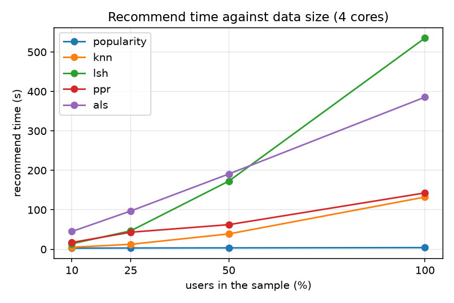
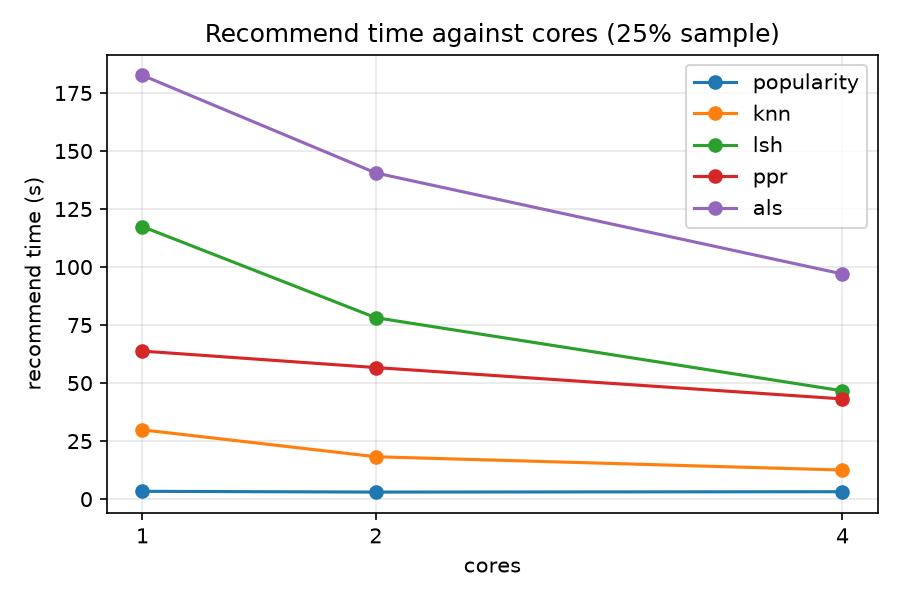

# Scalable top-10 movie recommendation on MovieLens 20M

ENSF 612, Group 9

## 1. Introduction

We compare five ways to recommend 10 movies to every user of MovieLens 20M (20,000,263 ratings by
138,493 users on 26,744 movies), all implemented on Apache Spark 4.0.1 (PySpark, local mode):

- **popularity**, the baseline: the most liked movies the user has not rated;
- **exact user-kNN**: movies liked by the 100 most similar users;
- **MinHash-LSH**: the same as kNN, but neighbours are found approximately with MinHash and banding;
- **Monte Carlo Personalized PageRank (PPR)**: random walks on the user–movie like graph;
- **ALS**: implicit-feedback matrix factorisation with Spark MLlib.

A rating of 4.0 or more counts as a like. Each method except popularity (which has no parameters) is
tuned on the validation stage of a 10% user sample. Every method is then tested once on two
time-ordered splits: `user_time` (each user's latest ratings are held
out) and `global_time` (everything after one date is held out).

**Research questions**

- **RQ1 (accuracy).** How accurate are the four methods, compared with each other and with the
  popularity baseline, on a per-user and on a global time split?
- **RQ2 (approximation).** How much accuracy does MinHash-LSH give up against exact user-kNN, and what
  does the approximation save?
- **RQ3 (scalability).** How does the run time of each method grow with the number of users, and how
  much does it gain from more cores?

Section 2 describes the data and the splits, Section 3 the evaluation protocol, Sections 4–7 the four
methods, Section 8 the paired comparisons between them, Section 9 the scalability runs, and Section 10
answers the research questions.

## 2. Data and splits

All numbers below are copied from `reports/data_profile.md`, `reports/data_quality.json` and
`reports/split_stats.md`, which `src/ingest.py` and `src/split.py` write. Before a member runs the test
stage, `tools/member.py check` confirms that their machine produced identical copies of these files.

### 2.1 Dataset

We use MovieLens 20M (GroupLens). After cleaning:

| Statistic | Value |
|---|---|
| Ratings | 20,000,263 |
| Users | 138,493 |
| Movies with at least one rating (in `movies.csv`) | 26,744 (27,278) |
| Density of the user–movie matrix | 0.54% |
| Likes (rating ≥ 4.0) | 9,995,410 (49.98%) |
| Period | 1995-01-09 11:46:44 to 2015-03-31 06:40:02 UTC |
| Ratings per user: min / median / mean / p99 / max | 20 / 68 / 144.41 / 1114 / 9254 |
| Likes per user: min / median / mean / p99 / max | 0 / 37 / 72.17 / 492 / 3177 |
| Ratings per movie: min / median / mean / p99 / max | 1 / 18 / 747.84 / 14396 / 67310 |
| Users without any like | 206 |
| Movies without any like / with only 1 rating | 6024 / 3972 |
| Share of ratings on the top 1% of movies | 33.48% |
| Ratings that share a timestamp with another rating of the same user | 30.9% |

The data is very sparse and skewed: a third of all ratings go to the top 1% of movies, while the
median movie has 18 ratings.

### 2.2 Cleaning

`src/ingest.py` applies five rules and counts every one of them in `reports/data_quality.json`, even
when the count is 0:

| Rule | Rows removed |
|---|---|
| 1. Missing or unparseable field (userId / movieId / rating / timestamp) | missing 0 / 0 / 0 / 0, unparseable 0 / 0 / 0 / 0 |
| 2. Rating outside 0.5–5.0 or not on a half-star step | 0 |
| 3. Timestamp outside the collection period (9 Jan 1995 – 31 Mar 2015) | 0 |
| 4. `movieId` not in `movies.csv` | 0 |
| 5. Duplicate user–movie pair (latest rating kept) | 0 |

No rating was removed: 20,000,263 rows raw and 20,000,263 clean. The rules stay in the pipeline so the
data is checked, not assumed clean. In `movies.csv`, 534 movies have no rating and get no dense id, so
no method can recommend them. 23 titles have no year and 246 movies have no genres; both are kept,
because the methods use neither titles nor genres. Users and movies are never removed for being
unusual, for example for having very many ratings.

### 2.3 Likes

A rating of 4.0 or more is a **like**. Likes are the positive signal for every method and for the
evaluation: a recommended movie is a hit if the user liked it in the target part.

### 2.4 Splits

**`user_time`.** Each user's ratings are sorted by (timestamp, movie id). The last ceil(20% of n)
ratings are test and the ceil(10% of n) before them are validation. The movie id breaks ties, because
30.9% of ratings share a timestamp with another rating of the same user; this makes the split
deterministic. Every user has at least 20 ratings, so every user keeps at least 13 for training.

**`global_time`.** Two timestamp cutoffs shared by all users: the latest 20% of all ratings are test
and the 10% before them are validation. Validation starts at 2007-12-08 01:20:38 UTC and test at
2009-10-20 07:33:43 UTC.

**Pilot samples.** `user_time_10pct` and `global_time_10pct` keep 10% of users with all their ratings.
Users are picked by a hash of their id, not by a random draw, so the samples are nested
(10% ⊂ 25% ⊂ 50%) and the same on every machine. All tuning used the validation stage of
`user_time_10pct`.

| Split | Part | Ratings | Share | Users | Movies | Likes |
|---|---|---|---|---|---|---|
| user_time | train | 13,883,097 | 69.41% | 138,493 | 20,656 | 7,087,069 |
| | val | 2,062,715 | 10.31% | 138,493 | 18,513 | 983,364 |
| | test | 4,054,451 | 20.27% | 138,493 | 25,139 | 1,924,977 |
| user_time_10pct | train | 1,382,688 | 69.42% | 13,671 | 13,616 | 705,219 |
| | val | 205,444 | 10.31% | 13,671 | 10,924 | 97,529 |
| | test | 403,760 | 20.27% | 13,671 | 14,654 | 190,945 |
| global_time | train | 14,000,184 | 70.0% | 100,793 | 9,696 | 7,047,751 |
| | val | 2,000,026 | 10.0% | 16,322 | 12,126 | 949,046 |
| | test | 4,000,053 | 20.0% | 31,670 | 26,349 | 1,998,613 |
| global_time_10pct | train | 1,400,308 | 70.3% | 9,936 | 9,127 | 704,545 |
| | val | 193,560 | 9.72% | 1,605 | 8,229 | 93,261 |
| | test | 398,024 | 19.98% | 3,168 | 14,557 | 195,887 |

Who can be evaluated at each stage (a user needs at least one liked target movie and at least one
training rating):

| Split | Stage | Evaluable users | Target users without history | Target likes on movies unseen in training |
|---|---|---|---|---|
| user_time | val | 130,411 | 0 | 453 of 983,364 |
| user_time | test | 135,599 | 0 | 1,782 of 1,924,977 |
| user_time_10pct | val | 12,905 | 0 | 284 of 97,529 |
| user_time_10pct | test | 13,385 | 0 | 985 of 190,945 |
| global_time | val | 4,538 | 11,673 | 93,714 of 949,046 |
| global_time | test | 5,542 | 26,027 | 300,783 of 1,998,613 |
| global_time_10pct | val | 447 | 1,146 | 9,525 of 93,261 |
| global_time_10pct | test | 568 | 2,589 | 31,287 of 195,887 |

### 2.5 What `global_time` can and cannot evaluate

`global_time` is the realistic setting: the model is trained on the past and judged on the future
for everyone at once. But it can judge only part of that future:

- At the test stage only **5,542 users** are evaluated, against 135,599 on `user_time`.
- **26,027 users** who rate in the test period have no training history. They are new users, and no
  method here can recommend for them, so they are left out of the evaluation.
- **300,783 of the 1,998,613 test likes** are on movies that do not appear in training (new movies).
  No method can recommend a movie it has never seen, so these likes can never be hits. This caps
  recall on `global_time`.

So `global_time` measures how well a method serves returning users on movies it already knows. It does
not measure cold start, for new users or new movies. Its intervals are also much wider than on
`user_time`, because it evaluates far fewer users.

## 3. Evaluation protocol

All five methods (popularity, exact user-kNN, MinHash-LSH, Monte Carlo PPR and ALS) go through the
same script, `src/run.py`. It loads one split and stage, calls the method's `recommend` function with
the training data only, writes the top-10 lists, and scores them with `src/evaluate.py`. So every
method is scored by the same code on the same users.

### 3.1 Stages

Each split (`user_time`, `global_time` and their 10% pilots) has three time-ordered parts: train,
validation and test.

- **Validation stage** (`--stage val`): the method trains on the train part and is scored on the
  validation part. All tuning was done here, on the 10% pilot of `user_time` (`user_time_10pct`).
- **Test stage** (`--stage test`): the method trains on train + validation and is scored on the test
  part. It runs once per method and split, with the parameters fixed in `tools/chosen.json`.
  `tools/member.py test` reads the parameters from that file, accepts none from the command line,
  and refuses to run a split again once it has a `metrics.json`.

### 3.2 Who is evaluated

A user is evaluated if they have at least one liked item (rating ≥ 4.0) in the target part and at
least one rating in the training part. The relevant items of a user are the items they liked in the
target part. An evaluated user who gets no list from a method still counts, with 0 for every metric,
so a method cannot gain by skipping hard users. Before scoring, the evaluation rejects lists with
duplicate items, duplicate ranks or ranks outside 1..10. It warns if a method recommends a movie the
user already rated in training. Such an item can never be a hit.

### 3.3 Metrics

All metrics use k = 10 and binary relevance (an item is a hit if the user liked it in the target part).
For one user with list positions r = 1..10 and R liked target items:

- **Precision@10** = hits / 10.
- **Recall@10** = hits / R.
- **NDCG@10** = DCG / IDCG, with DCG = Σ over hits of 1 / log2(r + 1), and IDCG the same sum for the
  first min(R, 10) positions (a perfect list).

Each is averaged over all evaluated users.

- **Coverage** = number of distinct items recommended to anyone / number of distinct items in the
  training part.

### 3.4 Uncertainty

Each metric has a 95% interval from a percentile bootstrap: 1,000 resamples of the evaluated users
with replacement, with a fixed seed (612). Users are sorted by id first, so every machine draws the
same resamples. Per-user values are saved in `results/<method>/<split>/<stage>/per_user`.

To compare two methods, `tools/compare.py` uses a **paired bootstrap**. It joins the per-user values
of both runs on the user id. It refuses to run if the two runs did not evaluate exactly the same
users. Then it resamples users 1,000 times, using the same resample for both methods. It reports the
mean difference A − B, its 95% interval, and the share of resamples where A is not better than B (a
one-sided p-value). Pairing removes the variation between users that both methods share, so the
interval for a difference is narrower than two separate intervals would suggest.

### 3.5 Why there is no leakage

- A method receives only the training DataFrame. The method contract forbids reading the
  validation or test files, and `src/run.py` passes nothing else.
- The splits are ordered in time. In `global_time`, two global timestamp cutoffs separate the parts,
  so a method never trains on a rating made after any rating it is scored on. In `user_time`, each
  user's last 20% of ratings are test and the 10% before them are validation. No user's own later
  ratings reach training, but the cutoff differs per user, so training can hold other users'
  ratings made after this user's test ratings. Only `global_time` gives a strict time order across
  users.
- Methods never recommend an item the user already rated in training.
- Tuning used only the validation stage of the 10% pilot. Parameters were fixed in
  `tools/chosen.json` before any test run, and each test split runs only once.
- The popularity and kNN test runs were made on the group's reference machine. Every other member
  runs the test stage on their own machine, and only after two checks. `tools/member.py check`
  confirms that the machine's data profile and split statistics are identical to the group's
  copies, so every machine scores on the same rows. `tools/member.py pilot` then re-runs the chosen
  parameters on the pilot's validation stage and must reproduce the group's metrics (within 0.002
  per metric, with the same evaluated users).

### 3.6 Reproducibility

Results do not depend on the number of cores or on Spark's partitioning:

- Users are scored in fixed batches of 256 sorted user ids, so batches depend only on the ids.
- Every top-n selection breaks ties by the lower id (`best_idx`), so ties never depend on input order.
- Random parts are seeded (seed 612). PPR seeds its random walks per batch with (seed, first user of
  the batch). LSH draws its hash functions from the seed. ALS uses the seed and fixed numbers of user
  and item blocks, so its factors do not change with the number of cores.
- Samples are chosen by a hash of the user id, not by a random draw, so they are nested
  (10% ⊂ 25% ⊂ 50%) and the same on every machine.
- The bootstrap sorts users by id before resampling.

## 4. Exact user-kNN

### 4.1 Method

Exact user-kNN recommends to each user the movies liked by the users whose taste is closest to theirs.
It is the reference that MinHash-LSH approximates, so it uses the same scoring.

For a user *u* with the set of liked movies *A_u* (ratings of 4.0 or more in the training part):

1. **Similarity to every other user.** For each movie in *A_u* we look up the users who liked it and count
   how often each user appears. That count is the overlap |A_u ∩ A_v| for every other user *v* at once.
   The similarity is cosine on the liked sets, |A_u ∩ A_v| / sqrt(|A_u| · |A_v|).
2. **Neighbours.** Keep the 100 most similar users. Ties go to the lower user id, so the result does not
   depend on how Spark partitions the data.
3. **Scores.** The score of a movie is the sum of the similarities of the neighbours who liked it. The 10
   best-scoring movies the user has not rated are recommended. A user with no likes, or with fewer than
   10 scored movies, is filled up with the most popular unseen movies.

**Implementation on Spark.** The training ratings are collected once and turned into three compressed
sparse arrays with numpy: user → rated movies, user → liked movies, movie → users who liked it. The arrays
are broadcast to all workers. Users are sorted by id and cut into fixed batches of 256, and the batches
are scored in parallel with `mapPartitions`. Because the batches depend only on the user ids, the
recommendations are identical for any number of cores.

The cost for one user is the total number of likes of the movies that user liked. Summed over users this
is the sum over movies of (number of likes)², so popular movies dominate the run time.

### 4.2 Parameters and tuning

Tuning used only the validation stage of the 10% pilot sample (`user_time_10pct`, 12,905 evaluated
users). The test part was not read.

| Configuration | P@10 | R@10 | NDCG@10 | Coverage | Recommend s |
|---|---|---|---|---|---|
| **100 neighbours, cosine (chosen)** | 0.0638 | 0.1310 | 0.1081 | 0.0533 | 74 |
| 100 neighbours, Jaccard | 0.0628 | 0.1290 | 0.1065 | 0.0558 | 54 |
| 50 neighbours, Jaccard (default) | 0.0624 | 0.1275 | 0.1057 | 0.0792 | 57 |
| 200 neighbours, Jaccard | 0.0618 | 0.1266 | 0.1050 | 0.0420 | 56 |
| 20 neighbours, Jaccard | 0.0605 | 0.1222 | 0.1021 | 0.1196 | 80 |

Accuracy changes little between 50 and 200 neighbours and is best at 100. Cosine is slightly better than
Jaccard at 100 neighbours. Fewer neighbours give more varied lists: coverage falls from 0.120 with 20
neighbours to 0.042 with 200.

### 4.3 Test results

One run per split, with the chosen configuration, training on train + validation.

| Split | Method | P@10 [95% CI] | R@10 [95% CI] | NDCG@10 [95% CI] | Coverage | Users | Recommend s |
|---|---|---|---|---|---|---|---|
| user_time | kNN | 0.1034 [0.1027, 0.1041] | 0.1140 [0.1131, 0.1151] | 0.1367 [0.1357, 0.1377] | 0.0875 | 135,599 | 1,634 |
| user_time | popularity | 0.0619 [0.0613, 0.0624] | 0.0619 [0.0612, 0.0626] | 0.0806 [0.0798, 0.0814] | 0.0129 | 135,599 | 38 |
| global_time | kNN | 0.1898 [0.1835, 0.1959] | 0.0503 [0.0481, 0.0528] | 0.2130 [0.2061, 0.2196] | 0.1390 | 5,542 | 1,428 |
| global_time | popularity | 0.1262 [0.1212, 0.1313] | 0.0337 [0.0318, 0.0362] | 0.1438 [0.1383, 0.1494] | 0.0267 | 5,542 | 36 |

All four runs were made on the same machine: 4 CPUs, Windows, Spark 4.0.1 in local mode with all cores
and an 8 GB driver heap.

### 4.4 Comparison with the baseline

Paired bootstrap over users (1,000 resamples, the same resample for both methods), kNN minus popularity:

| Split | Metric | Difference | 95% interval |
|---|---|---|---|
| user_time | Precision@10 | +0.0415 | [+0.0409, +0.0421] |
| user_time | Recall@10 | +0.0521 | [+0.0511, +0.0530] |
| user_time | NDCG@10 | +0.0561 | [+0.0552, +0.0570] |
| global_time | Precision@10 | +0.0636 | [+0.0599, +0.0672] |
| global_time | Recall@10 | +0.0166 | [+0.0146, +0.0187] |
| global_time | NDCG@10 | +0.0692 | [+0.0648, +0.0733] |

kNN is better than popularity on every metric and both splits, and no interval comes close to zero. On
`user_time`, NDCG@10 rises from 0.0806 to 0.1367. kNN also recommends a much wider part of the catalogue:
coverage is 0.0875 against 0.0129 on `user_time`.

The price is time. Producing the recommendations took 1,634 s on `user_time` against 38 s for popularity
on the same machine, about 43 times longer.

### 4.5 Limitations

- **Cost grows faster than the data.** The work is the sum over movies of (likes)², so doubling the number
  of users roughly quadruples it. This is the reason for comparing against MinHash-LSH.
- **Memory.** The whole training index is held in the driver and copied to every worker, so the method is
  limited by the memory of one machine.
- **New users and new movies.** A user with no likes only receives popular movies, and a movie nobody in
  training liked can never be recommended.
- **`global_time` evaluates few users.** Only 5,542 users have both training history and a liked movie
  after the cut-off, so its intervals are about seven times wider than on `user_time`.

## 5. MinHash-LSH user-kNN

### 5.1 Method

LSH replaces the exact neighbour search of user-kNN with an approximate one. Everything after the
neighbour search is the same as in exact kNN (`src/methods/knn.py`), so any difference between the
two methods comes from the neighbours alone.

The implementation (`src/methods/lsh.py`) works on each user's set of liked movies (rating ≥ 4.0)
in the training part:

1. **MinHash signatures.** Each user's liked set gets a signature of `n_hashes` values. Value j is the
   minimum of h_j(x) = (a_j·x + b_j) mod (2^31 − 1) over the liked movies x. The a_j and b_j come from
   a generator seeded with 612. Signatures are computed in fixed batches of 256 users on Spark
   workers, from the training index broadcast by `src/methods/_shared.py`.
2. **Banding.** The signature is cut into `bands` bands of r = n_hashes / bands values. Each band is
   hashed into one key. Spark groups users by (band, key), and users that share a bucket in at least
   one band become candidates for each other. A pair with Jaccard similarity s is found with
   probability 1 − (1 − s^r)^bands.
3. **Big buckets are skipped.** Buckets with more than `max_bucket` users (default 2,000) are left
   out. They come from very popular movies and would bring back the quadratic cost LSH is meant to
   avoid.
4. **Exact verification.** For every candidate the exact similarity (cosine or Jaccard on liked sets)
   is computed, and the `n_neighbours` best are kept (ties go to the lower user id).
5. **Scoring as in kNN.** A movie's score is the sum of the similarities of the neighbours who liked
   it. The 10 best movies the user has not rated are recommended. Users with no like or too few
   scored movies are filled with the most popular unseen movies.

### 5.2 Parameters and tuning

Tuning used only the validation stage of the 10% pilot (`user_time_10pct`, 12,905 evaluated users).
Unlisted parameters keep their defaults: n_hashes 128, bands 32, n_neighbours 50, max_bucket 2,000,
Jaccard similarity. Sorted by NDCG@10. All runs were made on the group's tuning machine.

| Tag | Parameters | P@10 | R@10 | NDCG@10 | Coverage | Recommend (s) |
|---|---|---|---|---|---|---|
| **chosen** | **n_hashes 256, bands 128, cosine, n_neighbours 100** | **0.0633** | **0.1295** | **0.1068** | **0.0773** | **152.6** |
| h64_b64 | n_hashes 64, bands 64 | 0.0624 | 0.1277 | 0.1058 | 0.0800 | 265.56 |
| h128_b128 | n_hashes 128, bands 128 | 0.0624 | 0.1276 | 0.1057 | 0.0800 | 309.1 |
| h256_b128 | n_hashes 256, bands 128 | 0.0623 | 0.1265 | 0.1049 | 0.0908 | 156.24 |
| h128_b64 | n_hashes 128, bands 64 | 0.0614 | 0.1236 | 0.1027 | 0.1028 | 128.35 |
| h128_b64_mb5000 | n_hashes 128, bands 64, max_bucket 5,000 | 0.0614 | 0.1236 | 0.1027 | 0.1028 | 116.91 |
| default | (defaults) | 0.0463 | 0.0994 | 0.0801 | 0.1537 | 112.49 |

The chosen configuration is fixed in `tools/chosen.json`. Before the test runs, this machine re-ran
it on the pilot and reproduced the group's NDCG@10 of 0.106837 exactly.

### 5.3 Test results

Train + validation → test, one run per split, with the chosen parameters.

| Method | Split | P@10 [95% CI] | R@10 [95% CI] | NDCG@10 [95% CI] | Coverage | Evaluated users | Recommend (s) |
|---|---|---|---|---|---|---|---|
| LSH | user_time | 0.1033 [0.1025, 0.1040] | 0.1138 [0.1128, 0.1148] | 0.1366 [0.1355, 0.1376] | 0.0879 | 135,599 | 522.59 |
| Popularity | user_time | 0.0619 [0.0613, 0.0624] | 0.0619 [0.0612, 0.0626] | 0.0806 [0.0798, 0.0814] | 0.0129 | 135,599 | 38.45 |
| LSH | global_time | 0.1901 [0.1835, 0.1961] | 0.0506 [0.0483, 0.0532] | 0.2125 [0.2054, 0.2190] | 0.1413 | 5,542 | 496.56 |
| Popularity | global_time | 0.1262 [0.1212, 0.1313] | 0.0337 [0.0318, 0.0362] | 0.1438 [0.1383, 0.1494] | 0.0267 | 5,542 | 35.53 |

The LSH runs were made on macOS 27.0.1 (arm64), 10 CPUs, Spark 4.0.1, 14g driver memory, all cores.
The popularity rows come from the group's runs on Windows 10 (AMD64), 4 CPUs, 8g driver memory.
Run times from the two machines are not comparable.

During the test runs LSH reported 12,493.0 candidates per user on average on `user_time` (360 users
without candidates; 206 buckets with more than 2,000 users skipped), and 13,221.8 on `global_time`
(142 users without candidates; 165 buckets skipped).

### 5.4 Comparison with the baseline

Paired bootstrap (1,000 resamples of the same users), LSH − popularity:

| Split | Users | ΔP@10 [95% CI] | ΔR@10 [95% CI] | ΔNDCG@10 [95% CI] |
|---|---|---|---|---|
| user_time | 135,599 | +0.0414 [+0.0408, +0.0421] | +0.0519 [+0.0509, +0.0527] | +0.0560 [+0.0551, +0.0568] |
| global_time | 5,542 | +0.0639 [+0.0603, +0.0675] | +0.0168 [+0.0147, +0.0190] | +0.0687 [+0.0643, +0.0728] |

LSH beats the popularity baseline on every metric on both splits. No interval comes near zero, and
the share of resamples where LSH was not better is 0.000 in all six cases. On `user_time`, NDCG@10
rises from 0.0806 to 0.1366, and coverage rises from 0.0129 to 0.0879.

### 5.5 Approximation quality

**Neighbour quality.** `tools/lsh_recall.py` compares the LSH top-100 neighbours with the exact
top-100 for a sample of users, on the training part of the validation stage (never the test part).

| Data | Users compared | Neighbour recall@100 | Similarity ratio | Candidates per user | Candidate step (s) |
|---|---|---|---|---|---|
| 10% pilot (group machine, from `tasks/lsh.md`) | | 0.8247 | 0.9464 | 1,885.7 | 78 |
| Full `user_time` (this machine) | 1,993 | 0.9164 | 0.9898 | 11,665.3 (median 11,371) | 108.8 |

Both rows use n_hashes 256, bands 128 (2 values per band), cosine similarity and max_bucket 2,000.
The candidate step time covers all users; the other columns are averages over the sampled users.

**Recommendation quality.** Paired bootstrap on `user_time` (test, 135,599 users), LSH − exact kNN:

| Metric | LSH | kNN | LSH − kNN [95% CI] | P(LSH ≤ kNN) |
|---|---|---|---|---|
| P@10 | 0.1033 | 0.1034 | −0.0001 [−0.0002, +0.0000] | 0.932 |
| R@10 | 0.1138 | 0.1140 | −0.0002 [−0.0005, +0.0000] | 0.942 |
| NDCG@10 | 0.1366 | 0.1367 | −0.0001 [−0.0003, +0.0001] | 0.918 |

What is given up: on the full data LSH finds 0.9164 of the exact top-100 neighbours, and the
neighbours it keeps have 0.9898 of the exact similarity mass. What is kept: the recommendations are
almost the same as exact kNN. The NDCG@10 difference is −0.0001 and its interval includes zero.
What is gained: the exact similarity is computed only for the candidates (11,665.3 per sampled user
on the full data) instead of every user who shares a liked movie. The kNN test run was made on the
group's Windows machine (4 CPUs) and the LSH run on this Mac (10 CPUs), so their recommend times are
not comparable; the time comparison is in Section 9.4.

### 5.6 Limitations

- **Memory.** The first `user_time` test run on this machine stopped with a Java heap
  `OutOfMemoryError` at the default 8g driver memory, before anything was scored. The rerun with 14g
  finished. The heap ran out while Spark was building and caching the per-user candidate lists,
  with 10 tasks running at once.
- **Candidates.** With 256 hashes in 128 bands (2 values per band) the banding is loose: on the full
  `user_time` data each user still got 12,493.0 candidates on average, and every candidate's exact
  similarity is computed. Very popular buckets (more than 2,000 users) are skipped, so a few true neighbours that
  only share such a bucket can be missed.
- **What `global_time` can evaluate.** Only users who rated before the cutoff and liked a movie after
  it are evaluated (5,542 users, against 135,599 on `user_time`), so its intervals are much wider.
- **Tuning scope.** Parameters were tuned on the `user_time` pilot only and reused for `global_time`,
  and the LSH − kNN comparison covers only `user_time` (the `global_time` comparison is in Section 8).

## 6. Monte Carlo Personalized PageRank (PPR)

### 6.1 Method

PPR scores movies for a user by random walks on a bipartite graph. Users and movies are the nodes, and
an edge joins a user to every movie they liked (rating ≥ 4.0) in the training part. A movie that is
visited often by walks starting at the user is close to the user's taste.

The implementation (`src/methods/ppr.py`) estimates these scores by simulation:

1. **Walks.** For a user u, `n_walkers` walkers start at u. At each of `n_steps` (20) steps a walker
   moves from its user to a random movie that user liked (this visit is counted), then to a random
   user who liked that movie. Then, with probability `alpha` (the restart), it jumps back to u.
   The visit counts over movies estimate u's PPR scores.
2. **Noise filter.** Movies visited fewer than `min_visits` times are dropped, because a count of one
   or two is mostly noise.
3. **Popularity penalty.** With `beta` > 0, each count is divided by (likes of the movie)^beta, which
   lowers the weight of very popular movies (as in RP3beta).
4. **Top 10.** The 10 highest-scoring movies the user has not rated are recommended (ties go to the
   lower movie id). Users with no like cannot start a walk, and they and any short list are filled
   with the most popular unseen movies.

On Spark, the training data is turned into compressed numpy arrays (user → liked movies, movie →
users who liked it) by `src/methods/_shared.py` and broadcast to every worker. Users are processed in
fixed batches of 256, and the walks of a whole batch are simulated together with numpy. Each batch
has its own random generator, seeded with (612, first user of the batch). Because the batches are
fixed, the results do not depend on the number of cores.

### 6.2 Parameters and tuning

Tuning used only the validation stage of the 10% pilot (`user_time_10pct`, 12,905 evaluated users).
Unlisted parameters keep their defaults: alpha 0.3, n_walkers 100, n_steps 20, beta 0, min_visits 1.
Sorted by NDCG@10. All runs were made on the group's tuning machine.

| Tag | Parameters | P@10 | R@10 | NDCG@10 | Coverage | Recommend (s) |
|---|---|---|---|---|---|---|
| **a0.3_w2500_b0.3_mv10 (chosen)** | **alpha 0.3, 2500 walkers, beta 0.3, min_visits 10** | **0.0462** | **0.0963** | **0.0800** | **0.0462** | **120.08** |
| a0.5_w1000 | alpha 0.5, 1000 walkers | 0.0453 | 0.0929 | 0.0781 | 0.0214 | 91.58 |
| a0.3_w1000_b0.3_mv5 | alpha 0.3, 1000 walkers, beta 0.3, min_visits 5 | 0.0455 | 0.0933 | 0.0780 | 0.0607 | 137.98 |
| a0.3_w1000_b0.5_mv10 | alpha 0.3, 1000 walkers, beta 0.5, min_visits 10 | 0.0454 | 0.0959 | 0.0776 | 0.1427 | 153.91 |
| a0.3_w2500 | alpha 0.3, 2500 walkers | 0.0440 | 0.0896 | 0.0763 | 0.0142 | 158.4 |
| a0.3_w1000 | alpha 0.3, 1000 walkers | 0.0439 | 0.0882 | 0.0757 | 0.0163 | 98.21 |
| a0.3_w250 | alpha 0.3, 250 walkers | 0.0406 | 0.0826 | 0.0689 | 0.0291 | 69.24 |
| a0.3 | alpha 0.3 | 0.0356 | 0.0731 | 0.0608 | 0.0499 | 65.12 |
| default | (defaults) | 0.0356 | 0.0731 | 0.0608 | 0.0499 | 67.2 |
| a0.5 | alpha 0.5 | 0.0348 | 0.0739 | 0.0606 | 0.0689 | 65.4 |
| a0.1 | alpha 0.1 | 0.0340 | 0.0670 | 0.0581 | 0.0412 | 75.96 |
| a0.3_b0.3 | alpha 0.3, beta 0.3 | 0.0113 | 0.0309 | 0.0226 | 0.7236 | 76.45 |
| a0.5_b0.5 | alpha 0.5, beta 0.5 | 0.0002 | 0.0007 | 0.0004 | 0.5874 | 74.75 |
| a0.3_b0.5 | alpha 0.3, beta 0.5 | 0.0001 | 0.0004 | 0.0002 | 0.5507 | 66.09 |
| a0.3_b0.7 | alpha 0.3, beta 0.7 | 0.0001 | 0.0002 | 0.0002 | 0.4682 | 66.51 |

The chosen configuration is fixed in `tools/chosen.json`.

### 6.3 Test results

Train + validation → test, one run per split, with the chosen parameters.

| Method | Split | P@10 [95% CI] | R@10 [95% CI] | NDCG@10 [95% CI] | Coverage | Evaluated users | Recommend (s) |
|---|---|---|---|---|---|---|---|
| PPR | user_time | 0.0749 [0.0743, 0.0755] | 0.0821 [0.0812, 0.0829] | 0.0985 [0.0976, 0.0993] | 0.0602 | 135,599 | 115.61 |
| Popularity | user_time | 0.0619 [0.0613, 0.0624] | 0.0619 [0.0612, 0.0626] | 0.0806 [0.0798, 0.0814] | 0.0129 | 135,599 | 38.45 |
| PPR | global_time | 0.1415 [0.1359, 0.1468] | 0.0370 [0.0349, 0.0395] | 0.1589 [0.1531, 0.1645] | 0.0606 | 5,542 | 87.19 |
| Popularity | global_time | 0.1262 [0.1212, 0.1313] | 0.0337 [0.0318, 0.0362] | 0.1438 [0.1383, 0.1494] | 0.0267 | 5,542 | 35.53 |

The PPR runs were made on macOS 27.0.1 (arm64), 10 CPUs, Spark 4.0.1, 14g driver memory, all cores.
The popularity rows come from the group's runs on Windows 10 (AMD64), 4 CPUs, 8g driver memory.
Run times from the two machines are not comparable.

### 6.4 Comparison with the baseline

Paired bootstrap (1,000 resamples of the same users), PPR − popularity:

| Split | Users | ΔP@10 [95% CI] | ΔR@10 [95% CI] | ΔNDCG@10 [95% CI] |
|---|---|---|---|---|
| user_time | 135,599 | +0.0130 [+0.0127, +0.0133] | +0.0201 [+0.0196, +0.0207] | +0.0179 [+0.0174, +0.0183] |
| global_time | 5,542 | +0.0153 [+0.0135, +0.0170] | +0.0033 [+0.0021, +0.0044] | +0.0151 [+0.0131, +0.0170] |

PPR beats the popularity baseline on every metric on both splits. All intervals are above zero, and
the share of resamples where PPR was not better is 0.000 in all six cases. The gain is modest: on
`user_time`, NDCG@10 rises from 0.0806 to 0.0985. Coverage rises from 0.0129 to 0.0602 on `user_time`.

### 6.5 Findings from tuning

- **More walkers help, with diminishing returns.** At alpha 0.3 with no penalty, NDCG@10 was 0.0608
  with 100 walkers, 0.0689 with 250, 0.0757 with 1000 and 0.0763 with 2500. Most of the gain comes by
  1000 walkers; going to 2500 moved NDCG@10 only from 0.0757 to 0.0763.
- **The popularity penalty `beta` works only together with `min_visits`.** Without a visit filter,
  beta collapses NDCG@10: 0.0226 with beta 0.3, and 0.0002 with beta 0.5 and 0.7 (alpha 0.3, 100
  walkers). Rarely visited movies have tiny like counts, so the penalty gives them the largest boost
  and they crowd out the rest; coverage jumps to 0.7236 with beta 0.3. With min_visits the penalty
  helps instead: with 2500 walkers, beta 0.3 and min_visits 10 gave the best result, 0.0800 against
  0.0763 without the penalty, and coverage rose from 0.0142 to 0.0462.
- **The restart probability `alpha` mattered little** at 100 walkers: 0.0581 (alpha 0.1), 0.0608 (0.3)
  and 0.0606 (0.5).

### 6.6 Limitations

- **Memory.** Each batch of 256 users keeps a dense count matrix with one value per user and movie,
  and the whole training index is broadcast to every worker. This fits MovieLens 20M on one machine,
  but memory grows with the number of movies.
- **Run time grows with the walkers.** On the pilot (alpha 0.3, no penalty), 100 walkers took 65.12 s,
  1000 took 98.21 s and 2500 took 158.4 s. The scores are a Monte Carlo estimate, so fewer walkers
  means noisier scores, and NDCG@10 drops (see Section 6.5).
- **One random seed.** All runs use seed 612. Because the scores come from random walks, another seed could
  give somewhat different numbers; we did not measure this.
- **What `global_time` can evaluate.** Only users who rated before the cutoff and liked a movie after
  it are evaluated (5,542 users, against 135,599 on `user_time`), so its intervals are much wider.
  Parameters were tuned on the `user_time` pilot only and reused for `global_time`.

## 7. ALS (Spark MLlib, implicit feedback)

### 7.1 Method

ALS factorises the user–movie matrix into a user factor matrix U and an item factor matrix V of a
chosen rank. The score of a movie for a user is the dot product of their two factor vectors. We use
the implicit-feedback version (Hu, Koren and Volinsky 2008). Every liked pair (rating ≥ 4.0) in the
training part is a positive with value 1, and every other pair is a weak negative. The parameter
`alpha` sets how much more confidence an observed like gets than an unobserved pair. `reg` is the L2
penalty on the factors.

The implementation (`src/methods/als.py`) has two parts:

- **Training on Spark.** `pyspark.ml.recommendation.ALS` is fitted on the liked pairs with
  `implicitPrefs=True`, a fixed seed (612), 10 iterations, and 10 user blocks and 10 item blocks.
  The block counts are fixed so the factors do not change with the number of cores.
- **Exact scoring with numpy.** The factors are collected to the driver as numpy arrays and broadcast
  with the training index from `src/methods/_shared.py`. Users are scored in fixed batches of 256.
  Each batch computes U·Vᵀ for all movies, removes every movie the user rated in training, and keeps
  the 10 best by `top_k` (ties go to the lower movie id). Only movies with a factor are candidates.
  A user with no factor (no like in training) gets the most popular unseen movies, as does any list
  with fewer than 10 candidates. MLlib's `recommendForAllUsers` is not used, because it cannot leave
  out seen movies.

### 7.2 Parameters and tuning

Tuning used only the validation stage of the 10% pilot (`user_time_10pct`, 12,905 evaluated users).
Unlisted parameters keep their defaults: rank 64, alpha 10, reg 0.05, 10 iterations, likes as the
signal. Sorted by NDCG@10. Recommend times were measured on the group's tuning machine.

| Tag | Parameters | P@10 | R@10 | NDCG@10 | Coverage | Recommend (s) |
|---|---|---|---|---|---|---|
| **r128_a1_reg0.1 (chosen)** | **rank 128, alpha 1, reg 0.1** | **0.0688** | **0.1412** | **0.1170** | **0.1095** | **383.89** |
| r64_a0.3 | rank 64, alpha 0.3 | 0.0668 | 0.1346 | 0.1128 | 0.0720 | 109.03 |
| r64_a1 | rank 64, alpha 1 | 0.0667 | 0.1355 | 0.1127 | 0.0783 | 123.38 |
| r64_a3 | rank 64, alpha 3 | 0.0657 | 0.1356 | 0.1107 | 0.0936 | 131.68 |
| r128_a1 | rank 128, alpha 1 | 0.0643 | 0.1306 | 0.1095 | 0.0997 | 279.28 |
| r128_a1_it15 | rank 128, alpha 1, 15 iterations | 0.0639 | 0.1293 | 0.1091 | 0.1005 | 393.65 |
| r128 | rank 128 | 0.0604 | 0.1281 | 0.1030 | 0.1361 | 282.36 |
| r64_reg0.1 | rank 64, reg 0.1 | 0.0618 | 0.1283 | 0.1025 | 0.1236 | 124.65 |
| default | (defaults) | 0.0610 | 0.1275 | 0.1019 | 0.1186 | 115.95 |
| r64 | rank 64 | 0.0610 | 0.1275 | 0.1019 | 0.1186 | 116.22 |
| r64_reg0.01 | rank 64, reg 0.01 | 0.0609 | 0.1267 | 0.1015 | 0.1144 | 122.41 |
| r32 | rank 32 | 0.0614 | 0.1240 | 0.1008 | 0.0994 | 78.68 |
| r64_a40 | rank 64, alpha 40 | 0.0521 | 0.1129 | 0.0870 | 0.1543 | 122.21 |
| r64_rating | rank 64, ratings as confidence | 0.0399 | 0.0902 | 0.0659 | 0.2062 | 137.75 |

The chosen configuration (rank 128, alpha 1.0, reg 0.1) is fixed in `tools/chosen.json`. Before the
test runs, this machine re-ran it on the pilot and reproduced the group's NDCG@10 of 0.117001 exactly.

### 7.3 Test results

Train + validation → test, one run per split, with the chosen parameters.

| Method | Split | P@10 [95% CI] | R@10 [95% CI] | NDCG@10 [95% CI] | Coverage | Evaluated users | Recommend (s) |
|---|---|---|---|---|---|---|---|
| ALS | user_time | 0.1120 [0.1113, 0.1128] | 0.1216 [0.1206, 0.1226] | 0.1474 [0.1464, 0.1484] | 0.0854 | 135,599 | 159.06 |
| Popularity | user_time | 0.0619 [0.0613, 0.0624] | 0.0619 [0.0612, 0.0626] | 0.0806 [0.0798, 0.0814] | 0.0129 | 135,599 | 38.45 |
| ALS | global_time | 0.1994 [0.1929, 0.2054] | 0.0519 [0.0497, 0.0546] | 0.2221 [0.2150, 0.2288] | 0.1613 | 5,542 | 162.62 |
| Popularity | global_time | 0.1262 [0.1212, 0.1313] | 0.0337 [0.0318, 0.0362] | 0.1438 [0.1383, 0.1494] | 0.0267 | 5,542 | 35.53 |

The ALS runs were made on macOS 27.0.1 (arm64), 10 CPUs, Spark 4.0.1, 8g driver memory, all cores.
The popularity rows come from the group's runs on Windows 10 (AMD64), 4 CPUs, 8g driver memory.
Run times from the two machines are not comparable.

### 7.4 Comparison with the baseline

Paired bootstrap (1,000 resamples of the same users), ALS − popularity:

| Split | Users | ΔP@10 [95% CI] | ΔR@10 [95% CI] | ΔNDCG@10 [95% CI] |
|---|---|---|---|---|
| user_time | 135,599 | +0.0502 [+0.0495, +0.0509] | +0.0596 [+0.0586, +0.0607] | +0.0668 [+0.0658, +0.0678] |
| global_time | 5,542 | +0.0732 [+0.0684, +0.0780] | +0.0181 [+0.0155, +0.0209] | +0.0783 [+0.0729, +0.0836] |

ALS beats the popularity baseline on every metric on both splits. No interval comes near zero, and
the share of resamples where ALS was not better is 0.000 in all six cases. On `user_time`, NDCG@10
rises from 0.0806 to 0.1474. ALS also recommends a much wider part of the catalogue (coverage 0.0854
against 0.0129 on `user_time`).

### 7.5 Findings from tuning and comparison with kNN

- **The confidence weight `alpha` mattered most.** At rank 64, NDCG@10 was 0.1128 with alpha 0.3,
  0.1127 with alpha 1, 0.1107 with alpha 3, 0.1019 with alpha 10 (the default) and 0.0870 with
  alpha 40. Alpha 0.3 and 1 are practically tied (difference 0.0001); alpha 1 was kept for the larger
  rank. Using the raw ratings as confidence instead of likes was much worse (0.0659), although it
  gave the highest coverage (0.2062).
- **Rank and reg helped only slightly.** With alpha 10, rank 32, 64 and 128 gave
  0.1008, 0.1019 and 0.1030. With alpha 1, going from rank 64 to 128 alone lowered NDCG@10 (0.1127 →
  0.1095). Raising reg from 0.05 to 0.1 at rank 128 then gave the best result, 0.1170. Without a
  rank-64, alpha-1, reg-0.1 run we cannot separate the effect of rank from that of reg. 15 iterations
  instead of 10 did not help (0.1091 vs 0.1095).
- **ALS against exact user-kNN** on `user_time` (test, 135,599 users, paired bootstrap):

| Metric | ALS | kNN | ALS − kNN [95% CI] |
|---|---|---|---|
| P@10 | 0.1120 | 0.1034 | +0.0086 [+0.0081, +0.0091] |
| R@10 | 0.1216 | 0.1140 | +0.0076 [+0.0068, +0.0084] |
| NDCG@10 | 0.1474 | 0.1367 | +0.0107 [+0.0100, +0.0114] |

  ALS is better than exact kNN on all three metrics, by about 0.01 NDCG@10. The intervals exclude
  zero. Coverage is close (ALS 0.0854, kNN 0.0875).

### 7.6 Limitations

- **Memory and the driver.** Both factor matrices are collected to the driver and broadcast to every
  worker, and each batch builds a dense 256 × (number of movies) score matrix. This fits MovieLens
  20M on one machine but would not scale to a much larger catalogue without approximate scoring.
- **Run time.** Recommend time (training plus scoring) grows with the rank. On the pilot, rank 64 took 116.22 s and rank 128
  took 282.36 s, and the chosen configuration took 383.89 s.
- **What `global_time` can evaluate.** Only users who rated before the cutoff and liked a movie after
  it are evaluated (5,542 users, against 135,599 on `user_time`), so its intervals are much wider.
  Its recall is low (0.0519) while its precision is high (0.1994): with only 10 slots per list,
  recall stays low when a user liked many movies in the test part.
- **Tuning scope.** Parameters were tuned on the `user_time` pilot only and reused for `global_time`.
  The grid was small: one parameter changed at a time from a few starting points.

## 8. Paired comparisons between methods

Each row is a paired bootstrap (`tools/compare.py`): the per-user metrics of two test runs are joined on
the user id, users are resampled 1,000 times with the same resample for both methods (seed 612), and the
table gives the mean difference A − B with its 95% interval. P(A ≤ B) is the share of resamples where A
was not better than B. Both runs always evaluate exactly the same users. Logs: `logs/compare/`.

Each method is compared with exact kNN (the reference that LSH approximates), and the best method on both
splits, ALS, is compared with every other method.

### 8.1 user_time (135,599 users)

| A − B | ΔP@10 [95% CI] | ΔR@10 [95% CI] | ΔNDCG@10 [95% CI] | P(A ≤ B), NDCG |
|---|---|---|---|---|
| LSH − kNN | −0.0001 [−0.0002, +0.0000] | −0.0002 [−0.0005, +0.0000] | −0.0001 [−0.0003, +0.0001] | 0.918 |
| ALS − kNN | +0.0086 [+0.0081, +0.0091] | +0.0076 [+0.0068, +0.0084] | +0.0107 [+0.0100, +0.0114] | 0.000 |
| PPR − kNN | −0.0285 [−0.0291, −0.0279] | −0.0319 [−0.0328, −0.0312] | −0.0382 [−0.0390, −0.0375] | 1.000 |
| ALS − LSH | +0.0088 [+0.0083, +0.0092] | +0.0078 [+0.0070, +0.0086] | +0.0108 [+0.0101, +0.0115] | 0.000 |
| ALS − PPR | +0.0371 [+0.0365, +0.0378] | +0.0395 [+0.0386, +0.0405] | +0.0489 [+0.0480, +0.0498] | 0.000 |
| ALS − popularity | +0.0502 [+0.0495, +0.0509] | +0.0596 [+0.0586, +0.0607] | +0.0668 [+0.0658, +0.0678] | 0.000 |

### 8.2 global_time (5,542 users)

| A − B | ΔP@10 [95% CI] | ΔR@10 [95% CI] | ΔNDCG@10 [95% CI] | P(A ≤ B), NDCG |
|---|---|---|---|---|
| LSH − kNN | +0.0003 [−0.0007, +0.0012] | +0.0002 [−0.0003, +0.0007] | −0.0005 [−0.0014, +0.0004] | 0.854 |
| ALS − kNN | +0.0096 [+0.0064, +0.0131] | +0.0015 [−0.0006, +0.0038] | +0.0091 [+0.0055, +0.0128] | 0.000 |
| PPR − kNN | −0.0483 [−0.0515, −0.0450] | −0.0133 [−0.0151, −0.0116] | −0.0540 [−0.0578, −0.0504] | 1.000 |
| ALS − LSH | +0.0093 [+0.0059, +0.0126] | +0.0013 [−0.0008, +0.0036] | +0.0096 [+0.0061, +0.0133] | 0.000 |
| ALS − PPR | +0.0579 [+0.0534, +0.0625] | +0.0149 [+0.0123, +0.0175] | +0.0632 [+0.0582, +0.0681] | 0.000 |
| ALS − popularity | +0.0732 [+0.0684, +0.0780] | +0.0181 [+0.0155, +0.0209] | +0.0783 [+0.0729, +0.0836] | 0.000 |

### 8.3 What the comparisons show

- **The ranking is the same on both splits:** ALS > exact kNN ≈ LSH > PPR > popularity, by NDCG@10.
- **ALS is the best method.** It beats every other method on P@10 and NDCG@10 on both splits, with all
  intervals above zero. On `global_time` its recall advantage over kNN (+0.0015 [−0.0006, +0.0038]) and
  over LSH (+0.0013 [−0.0008, +0.0036]) is not significant.
- **LSH matches exact kNN.** Every LSH − kNN interval contains zero on both splits.
- **PPR is clearly below kNN** on every metric on both splits, though it still beats popularity
  (Section 6).
- The intervals on `global_time` are much wider than on `user_time`, because it evaluates 5,542 users
  against 135,599. Differences should only be compared within one split: the two splits evaluate
  different users with different targets (Section 2).

## 9. Scalability

### 9.1 Setup

Every method ran with its chosen parameters (`tools/chosen.json`) on the validation stage of `user_time`
(train → val; the test part is never used here), 30 runs in total (`tools/scale.py`):

- **Data size:** 10%, 25%, 50% and 100% of users, with 4 cores.
- **Cores:** 1 and 2 cores on the 25% sample (the 4-core point comes from the first set).

Users are sampled by a hash of their id (`common.user_sample`), so the samples are nested
(10% ⊂ 25% ⊂ 50% ⊂ 100%). The 10% sample is the tuning pilot: each method's 10% run gives exactly its
pilot validation NDCG@10 (for example ALS 0.117001, kNN 0.1081).

**All 30 timings come from one machine:** macOS 27.0.1 on Apple Silicon (arm64), 10 CPUs, 24 GB RAM,
Spark 4.0.1 in local mode, `--driver-memory 14g` for every run (8g ran out of memory for LSH on this
machine). Only these timings can be compared with each other. The "recommend seconds" in the test-result
tables of the method sections come from each member's own machine and must **not** be compared across
methods.

"Recommend time" is the wall-clock time of the method's `recommend` call: building the index, training
(ALS), scoring all users and writing the lists. It does not include evaluation.

### 9.2 Time against data size (4 cores)

| Method | 10% | 25% | 50% | 100% | NDCG@10 at 100% |
|---|---|---|---|---|---|
| popularity | 2.73 s | 3.19 s | 3.49 s | 4.11 s | 0.0642 |
| exact kNN | 5.06 s | 12.52 s | 38.91 s | 132.33 s | 0.1132 |
| LSH | 13.92 s | 46.65 s | 172.75 s | 535.49 s | 0.1131 |
| PPR | 17.13 s | 43.18 s | 62.36 s | 142.84 s | 0.0806 |
| ALS | 44.97 s | 97.01 s | 190.82 s | 385.66 s | 0.1214 |

Evaluated users: 12,905 / 32,278 / 64,883 / 130,411.

- **Popularity** barely changes with size: its runs take a few seconds and are dominated by fixed Spark
  overhead.
- **ALS and PPR** grow roughly in proportion to the number of users: going from 50% to 100% of users
  doubles the users, and their time goes from 190.82 s to 385.66 s (ALS) and from 62.36 s to 142.84 s (PPR).
- **Exact kNN and LSH** grow faster than the number of users: from 50% to 100%, kNN goes from 38.91 s to
  132.33 s and LSH from 172.75 s to 535.49 s. Both compare each user with other users, so more users means
  both more users to score and more neighbours to check per user.

### 9.3 Time against cores (25% sample)

| Method | 1 core | 2 cores | 4 cores | Speed-up 1→4 |
|---|---|---|---|---|
| popularity | 3.36 s | 3.03 s | 3.19 s | 1.05× |
| exact kNN | 29.85 s | 18.26 s | 12.52 s | 2.38× |
| LSH | 117.43 s | 78.18 s | 46.65 s | 2.52× |
| PPR | 63.78 s | 56.69 s | 43.18 s | 1.48× |
| ALS | 182.61 s | 140.55 s | 97.01 s | 1.88× |

(Speed-ups from `reports/results.md`.)

- kNN and LSH scale best with cores: their per-user scoring is independent across the fixed batches of
  256 users. Neither reaches the ideal 4×; a likely reason is that part of each run is not parallel
  (the training index is built on the driver and broadcast before the scoring starts).
- ALS gains less. A likely reason is that MLlib's alternating least squares works on a fixed number of
  blocks and has to synchronise after every iteration. We did not measure where the time goes.
- PPR gains the least of the four (1.48×) on this sample.
- Popularity does not get faster at all; its time is Spark overhead.
- For every method NDCG@10 on the 25% sample is identical on 1, 2 and 4 cores (popularity 0.063721, kNN
  0.109253, LSH 0.108492, PPR 0.079758, ALS 0.118417): the results do not depend on the number of cores.

### 9.4 LSH against exact kNN: what the approximation buys

| | 10% | 25% | 50% | 100% |
|---|---|---|---|---|
| exact kNN time | 5.06 s | 12.52 s | 38.91 s | 132.33 s |
| LSH time | 13.92 s | 46.65 s | 172.75 s | 535.49 s |

LSH finds 0.9164 of the exact top-100 neighbours on the full data (0.8247 on the 10% pilot), and its
test NDCG@10 is the same as exact kNN within the bootstrap interval (Section 5). But on this
machine **LSH is slower than exact kNN at every data size**, and the gap grows with the data (535.49 s
against 132.33 s at 100%). With the chosen setting (256 hashes in 128 bands, 2 values per band) the
banding is loose: on the full validation training data each sampled user still has 11,665.3 candidates
on average (Section 5), and grouping users into buckets is extra work on top of the exact
similarity of every candidate. Exact kNN, which gets each user's overlaps in one pass over the
item → likers index, is already fast at this size. A stricter banding (more values per band) would give
fewer candidates and could make LSH faster, but it lost accuracy in tuning, and the group did not tune
for time.

### 9.5 Notes on the runs

- One run was repeated: the first PPR 50% run overlapped a sleep of the laptop (the lid was closed 27 s
  after the run started), so its time (531.9 s) included sleep. It was run again with the laptop on AC
  power and kept awake: 62.36 s, with the same NDCG@10. Details are in `tasks/scale.md`.
- The first 20 runs ran on battery and the last 10 on AC power; Low Power Mode was off on both, so the
  CPU speed is the same.
- Not measured: shuffle bytes and peak memory per run.

## 10. Conclusion

**RQ1: How accurate are the methods?** Test NDCG@10 with 95% intervals:

| Method | user_time | global_time |
|---|---|---|
| ALS | 0.1474 [0.1464, 0.1484] | 0.2221 [0.2150, 0.2288] |
| exact kNN | 0.1367 [0.1357, 0.1377] | 0.2130 [0.2061, 0.2196] |
| MinHash-LSH | 0.1366 [0.1355, 0.1376] | 0.2125 [0.2054, 0.2190] |
| PPR | 0.0985 [0.0976, 0.0993] | 0.1589 [0.1531, 0.1645] |
| popularity | 0.0806 [0.0798, 0.0814] | 0.1438 [0.1383, 0.1494] |

All four methods beat the popularity baseline on every metric on both splits. ALS is the most
accurate: it beats exact kNN by +0.0107 [+0.0100, +0.0114] NDCG@10 on `user_time` and by
+0.0091 [+0.0055, +0.0128] on `global_time` (Section 8). Exact kNN and LSH come next and are
statistically tied. PPR is clearly below kNN (−0.0382 [−0.0390, −0.0375] on `user_time`), but still
above popularity. The ranking ALS > kNN ≈ LSH > PPR > popularity is the same on both splits.
`global_time` gives higher precision and NDCG but lower recall for every method; its numbers cannot be
compared with `user_time`, because it evaluates different and far fewer users (5,542 against 135,599),
with different targets (Section 2.5).

**RQ2: What does the LSH approximation cost and save?** On accuracy it costs almost nothing. LSH
finds 0.9164 of the exact top-100 neighbours on the full data, with 0.9898 of their similarity, and its
recommendations are as good as exact kNN: −0.0001 [−0.0003, +0.0001] NDCG@10 on `user_time` and
−0.0005 [−0.0014, +0.0004] on `global_time`. But with the chosen parameters it saves no time. On one
machine, LSH took 535.49 s on all users against 132.33 s for exact kNN (4 cores), and it was slower at
every data size (Section 9.4). Its banding is loose (2 values per band), so each user still has 11,665.3
candidates on average, and finding them costs more than exact kNN's direct pass over the item → likers
index at this data size. Stricter banding cut accuracy in tuning (Section 5.2).

**RQ3: How do the methods scale?** On one machine (10 CPUs, Apple Silicon, 4 cores used), going from
50% to 100% of users roughly doubles the time of ALS (190.82 s → 385.66 s), while exact kNN
(38.91 s → 132.33 s) and LSH (172.75 s → 535.49 s) grow faster than the data, because they compare users
with each other. PPR (62.36 s → 142.84 s) sits in between, and popularity stays at a few seconds. From 1 to
4 cores, LSH and kNN gain the most (2.52× and 2.38×), ALS less (1.88×), PPR 1.48×, and popularity
nothing. Every method gives exactly the same recommendations on 1, 2 and 4 cores.

**Overall.** ALS gives the best accuracy at a run time that grows in proportion to the data. Exact kNN
is the fastest of the accurate methods at this data size, but its cost grows fastest with more users.
LSH matches its accuracy but, with these settings, not its speed.

**Limitations.** All runs use Spark in local mode on single laptops, so memory, not the cluster, is the
limit (LSH needed a 14 GB heap). Test-run times come from different machines and are not compared; only
the scalability runs (Section 9) are. `global_time` cannot evaluate new users or new movies. Shuffle
volume and peak memory per run were not measured.
