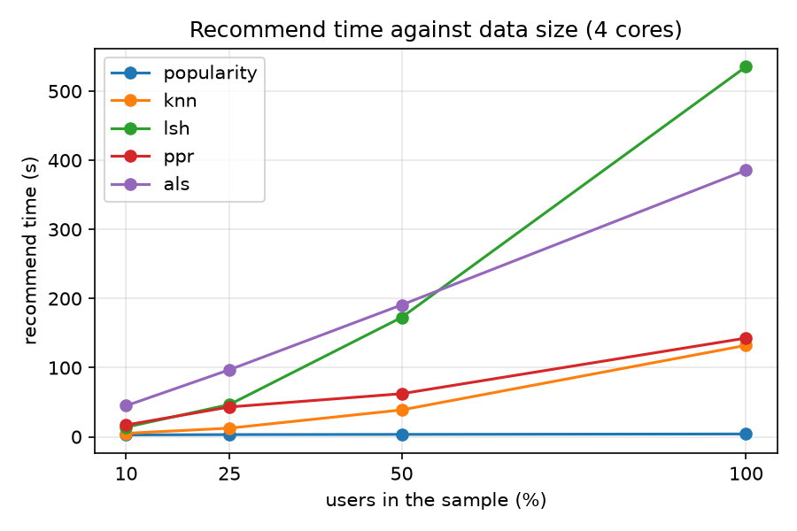
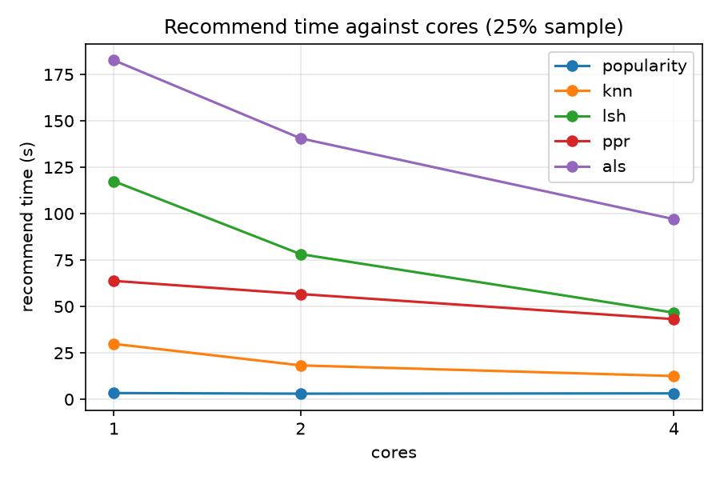

# Scalability (RQ3)

## 1. Setup

Every method ran with its chosen parameters (`tools/chosen.json`) on the validation stage of `user_time`
(train → val; the test part is never used here), 30 runs in total (`tools/scale.py`):

- **Data size:** 10%, 25%, 50% and 100% of users, with 4 cores.
- **Cores:** 1 and 2 cores on the 25% sample (the 4-core point comes from the first set).

Users are sampled by a hash of their id (`common.user_sample`), so the samples are nested
(10% ⊂ 25% ⊂ 50% ⊂ 100%). The 10% sample is the tuning pilot: each method's 10% run gives exactly its
pilot validation NDCG@10 (for example ALS 0.117001, kNN 0.1081).

**All 30 timings come from one machine:** macOS 27.0.1 on Apple Silicon (arm64), 10 CPUs, 24 GB RAM,
Spark 4.0.1 in local mode, `--driver-memory 14g` for every run (8g ran out of memory for LSH on this
machine). Only these timings can be compared with each other. The "recommend seconds" in the test-result
tables of the method sections come from each member's own machine and must **not** be compared across
methods.

"Recommend time" is the wall-clock time of the method's `recommend` call: building the index, training
(ALS), scoring all users and writing the lists. It does not include evaluation.

## 2. Time against data size (4 cores)

| Method | 10% | 25% | 50% | 100% | NDCG@10 at 100% |
|---|---|---|---|---|---|
| popularity | 2.73 s | 3.19 s | 3.49 s | 4.11 s | 0.0642 |
| exact kNN | 5.06 s | 12.52 s | 38.91 s | 132.33 s | 0.1132 |
| LSH | 13.92 s | 46.65 s | 172.75 s | 535.49 s | 0.1131 |
| PPR | 17.13 s | 43.18 s | 62.36 s | 142.84 s | 0.0806 |
| ALS | 44.97 s | 97.01 s | 190.82 s | 385.66 s | 0.1214 |

Evaluated users: 12,905 / 32,278 / 64,883 / 130,411.

- **Popularity** barely changes with size: its runs take a few seconds and are dominated by fixed Spark
  overhead.
- **ALS and PPR** grow roughly in proportion to the number of users: going from 50% to 100% of users
  doubles the users, and their time goes from 190.82 s to 385.66 s (ALS) and from 62.36 s to 142.84 s (PPR).
- **Exact kNN and LSH** grow faster than the number of users: from 50% to 100%, kNN goes from 38.91 s to
  132.33 s and LSH from 172.75 s to 535.49 s. Both compare each user with other users, so more users means
  both more users to score and more neighbours to check per user.

## 3. Time against cores (25% sample)

| Method | 1 core | 2 cores | 4 cores | Speed-up 1→4 |
|---|---|---|---|---|
| popularity | 3.36 s | 3.03 s | 3.19 s | 1.05× |
| exact kNN | 29.85 s | 18.26 s | 12.52 s | 2.38× |
| LSH | 117.43 s | 78.18 s | 46.65 s | 2.52× |
| PPR | 63.78 s | 56.69 s | 43.18 s | 1.48× |
| ALS | 182.61 s | 140.55 s | 97.01 s | 1.88× |

(Speed-ups from `reports/results.md`.)

- kNN and LSH scale best with cores: their per-user scoring is independent across the fixed batches of
  256 users. Neither reaches the ideal 4×; a likely reason is that part of each run is not parallel
  (the training index is built on the driver and broadcast before the scoring starts).
- ALS gains less. A likely reason is that MLlib's alternating least squares works on a fixed number of
  blocks and has to synchronise after every iteration. We did not measure where the time goes.
- PPR gains the least of the four (1.48×) on this sample.
- Popularity does not get faster at all; its time is Spark overhead.
- For every method NDCG@10 on the 25% sample is identical on 1, 2 and 4 cores (popularity 0.063721, kNN
  0.109253, LSH 0.108492, PPR 0.079758, ALS 0.118417): the results do not depend on the number of cores.

## 4. LSH against exact kNN: what the approximation buys

| | 10% | 25% | 50% | 100% |
|---|---|---|---|---|
| exact kNN time | 5.06 s | 12.52 s | 38.91 s | 132.33 s |
| LSH time | 13.92 s | 46.65 s | 172.75 s | 535.49 s |

LSH finds 0.9164 of the exact top-100 neighbours on the full data (0.8247 on the 10% pilot), and its
test NDCG@10 is the same as exact kNN within the bootstrap interval (`report/lsh.md`). But on this
machine **LSH is slower than exact kNN at every data size**, and the gap grows with the data (535.49 s
against 132.33 s at 100%). With the chosen setting (256 hashes in 128 bands, 2 values per band) the
banding is loose: on the full validation training data each sampled user still has 11,665.3 candidates
on average (`report/lsh.md`), and grouping users into buckets is extra work on top of the exact
similarity of every candidate. Exact kNN, which gets each user's overlaps in one pass over the
item → likers index, is already fast at this size. A stricter banding (more values per band) would give
fewer candidates and could make LSH faster, but it lost accuracy in tuning, and the group did not tune
for time.

## 5. Notes on the runs

- One run was repeated: the first PPR 50% run overlapped a sleep of the laptop (the lid was closed 27 s
  after the run started), so its time (531.9 s) included sleep. It was run again with the laptop on AC
  power and kept awake: 62.36 s, with the same NDCG@10. Details are in `tasks/scale.md`.
- The first 20 runs ran on battery and the last 10 on AC power; Low Power Mode was off on both, so the
  CPU speed is the same.
- Not measured: shuffle bytes and peak memory per run.
